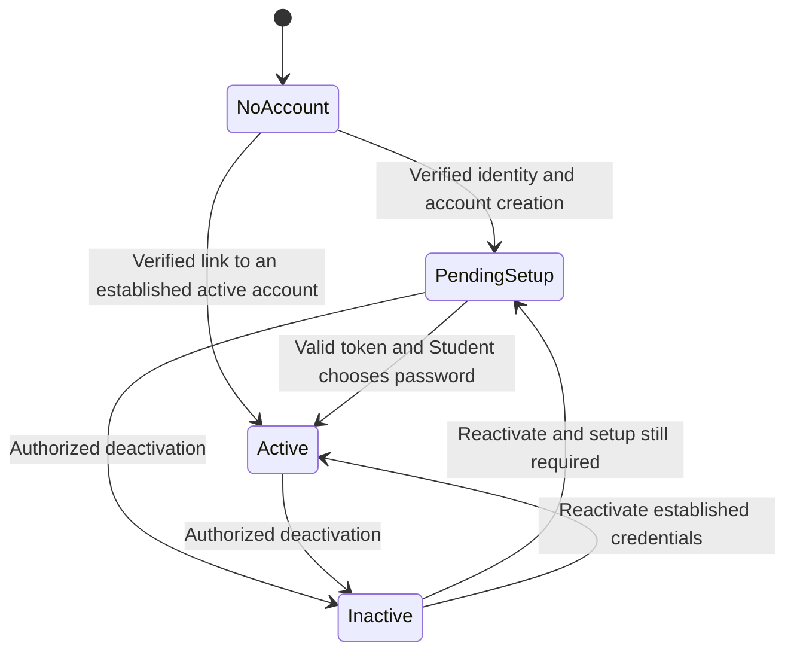

# 16 - Student account management interface design

> **Student profile update (2026-11-19):** The user has now requested Student self-service information editing. An enabled, correctly linked Student can edit their own allowlisted personal/contact/address/family fields through My student profile. Staff-only record and account permissions remain. See [current implementation and actual test results](24-student-profile-editing.md); earlier read-only/deferred scope below is historical.

> **Initial password setup update (2026-11-19):** The user requested a dedicated Student password form. Authorized Registrar/Test Administrator users can now complete initial setup for an eligible linked pending Student from Manage login, without email. Saving a valid password clears the pending flag and verifies profile access atomically. See [implementation, layout and actual test evidence](22-student-initial-password-form.md). Earlier stage limitations below are retained as history.

> **Latest approved change (2026-11-19):** The user now permits pending account creation without email. Creation no longer requires mail readiness and sends no notification/token. Both password-link buttons are removed. Secure setup remains required before Student login; credential-delivery safeguards remain. See [current behavior and tests](21-student-account-creation-without-email.md). Earlier results below are historical and do not override this change.

> **Current-stage update (2026-11-18):** Create-only Student account provisioning and a dedicated receipt-verification mechanism are now implemented. Mail credentials remain blank at the user's request, so live creation/delivery remain blocked. The lifecycle migration was already applied and verified. See [current implementation and actual test evidence](19-scholar-account-creation-implementation.md). Earlier implementation results below are retained as historical scope. Web existing-account linking remains removed.

**Date:** 2026-11-18, Asia/Manila  
**Status:** Reviewed and approved with the credential-delivery override below;
interface/lifecycle implementation and deployment are not complete.

**Subsequent approval record (2026-11-18):** The user selected Registrar plus
the retained Test Administrator exception (D01-B), approved the documented
D03-D06 defaults, and required **all new account creation to remain blocked
until real credential delivery is approved and tested**. That D02 choice
supersedes this original proposal's optional creation of pending accounts while
delivery is unavailable. Original proposal text below is retained as design
history; apply this approval record where it differs. See
[provisioning service implementation and limitations](16-student-account-provisioning-service.md).

## 1. Executive summary

Provide an authenticated application page where authorized Registrars can find
an existing Student, inspect login access, provision or explicitly link an
account, request secure credential setup/reset, and deactivate/reactivate
Student access. **Scholarship approval, award activation, academic eligibility,
funding and payroll are not prerequisites for login access.** Identity checks
and password setup are account-security steps, not scholarship approvals.

Reuse Laravel/Breeze, the existing `users`, `user_roles`, `students.user_id`,
password broker, audit table and Blade design. Extract the verified linking
rules into one application action shared by console and web callers. Recommend
two additive lifecycle fields on `users`; no new role catalog, registration
system, credential table, frontend framework or package is proposed.

Two decisions prevent this being an implementation-ready authorization:
Registrar-only access needs reconciliation with the documented full-feature
Test Administrator exception, and secure credential delivery needs an approved
channel. The current mailer writes to logs. This document proposes concrete
defaults and records the choices; it does not silently resolve those decisions.

## 2. Existing implementation: confirmed findings

### References and evidence

Read the following reports in full and inspected their current source references:

- [Student role implementation](15-student-role-implementation.md)
- [Initial verification / SR-01](15-student-role-verification.md)
- [Provisioning fix](15-student-provisioning-fix.md)
- [Independent reverification](15-student-role-reverification.md)
- [Existing access requirements](sms/auth-access-review.md) and the
  [latest role clarification](sms/implementation-plan.md#latest-role-and-recording-clarification-2026-11-12)

The independent report records **557 passing repository tests and 15 passing
QA checks**, including the original capitalization case on MariaDB. Those are
historical verification results for the existing implementation, not tests of
this proposed interface. The initial implementation report's `firstOrCreate`
description is superseded by the fix and reverification reports.

| Area | Current implementation and source |
| --- | --- |
| Versions | Installed/locked Laravel **12.69.2**, Breeze **2.4.2**, PHPUnit **11.5.56**; `composer.lock` and read-only application bootstrap. |
| Authentication | Laravel/Breeze email/password, `web` session guard and Eloquent User provider; hashed password cast, login throttling, session regeneration, intended redirects and logout rotation. `config/auth.php`, `LoginRequest.php`, `AuthenticatedSessionController.php`. |
| Roles | Multiple `user_roles` memberships; exact lowercase `student`; strict PHP comparison in `User::hasAnyRole()`. Staff sets retain Administrator, Registrar, Coordinator and legacy Finance/Viewer. `app/Models/User.php:15`, `:73`. |
| Association | `Student::user()` / `User::student()` reuse nullable, unique `students.user_id`. Student number is unique; membership uniqueness is `(user_id, role)`. FKs restrict deleting linked accounts. Foundation migration `2026_11_11_000000...:22`, `:38`. |
| Existing Student access | `/student/profile` selects the authenticated User's relationship and checks exact membership/ownership; official details are read-only. No record-ID route or email-based automatic claiming. `StudentProfileController.php:14`, `StudentPolicy.php:12`. |
| Registrar pages | Registrar can manage Student identity/profile records and academic verification through existing policies. `/scholars` already searches number/name/email and filters records. Academic verification write authority remains separate from account access. `ScholarController.php`, `ScholarRequest.php`, `AcademicRecordPolicy.php`. |
| Account management | No browser Student account management or role editor exists. `/profile` updates the current account's validated name/email; password changes require its current password. Linked deletion is refused by the existing FK/error handling. `ProfileController.php`, `ProfileUpdateRequest.php`, auth controllers. |
| Provisioning | `sms:link-student` links existing User/Student records only. It does not create User credentials. `sms:grant-role` only grants its existing Coordinator/Registrar choices. Neither is exposed through HTTP. |
| Password recovery | Existing guest forgot/reset routes use the `users` broker and hashed `password_reset_tokens`. Current expiry is **60 minutes**, issue throttle **60 seconds**. The reset-link controller currently displays differing broker status/error responses; generic anti-enumeration messages are a proposal, not an existing guarantee. `routes/auth.php`, `config/auth.php`, reset controllers. |
| Email verification | Routes and signed verification handling exist, but `User` does not implement `MustVerifyEmail`. Consequently `verified` middleware does not currently enforce mailbox verification. Do not describe it as an activation system. |
| Account lifecycle | No enabled/disabled/pending-setup column or enforcement exists on User. Student `record_status` is **active/archived**; scholarship assignments and reference-program availability have other states. None represents login activation/deactivation. |
| Frontend | Server-rendered Blade, Breeze components, Alpine, Vite, Tailwind configuration and shared `resources/css/app.css`. Reuse `records-page`, cards, fields, badges, navigation and shared table controls. No SPA/API frontend is needed. |
| Audit | `audit_events`, `AuditEvent`, `RecordAudit` and existing console audit records. `RecordAudit` snapshots fillable fields; it is not a safe generic User credential-audit serializer. |

### Read-only database/configuration audit for this design

The configured database uses Laravel's `mysql` driver on **MariaDB 10.11.16**.
No account, token, session or other database record was created or changed.
Only schema inspection, aggregate reads and preservation fingerprints ran.

| Observation on 2026-11-18 | Result |
| --- | ---: |
| Existing Students | 317 |
| Missing/null/blank Student email | 6 |
| Nonempty email values failing basic PHP email-format validation | 0 |
| Values requiring lowercase/edge-trim normalization | 3 |
| Duplicate normalized Student email groups, PHP normalization | 0 |
| Duplicate normalized email groups under actual database collation | 0 |
| Students linked to a User | 1 |
| Student email matching an existing User email | 1 |
| Linked Student/User email mismatches | 0 |
| Existing User accounts | 4 |

`users.email` has a unique index; `students.email` is nullable and **not unique**.
The inspected email collation is `utf8mb4_unicode_ci`. Presently absent duplicates
do not establish a uniqueness contract. Format validation does not establish
ownership, deliverability or that imported addresses are current. Student contact
email and User login email are separate fields and may legitimately diverge.
No addresses, account credentials or private identifiers are reproduced here.

Current mail transport is **`log`**, not a verified outbound delivery service.
Current session storage is **`database`**. No message was sent and no token was
generated to inspect these settings.

### Verified linking behavior to retain

`app/Console/Commands/LinkStudentAccount.php` and all of
`tests/Feature/Auth/StudentProvisioningRegressionTest.php` were reviewed:

- Lock User, Student and relevant memberships in one transaction; reject missing
  records or either direction of conflicting association before changing access.
- Inspect stored role values, not case-insensitive SQL equality. Exactly one
  eligible `strtolower(trim(role)) === 'student'` variant may be canonicalized
  **in place**. Multiple variants fail; unrelated roles and credentials remain.
- Create only canonical `student` if absent; retain database uniqueness guards.
- Audit changed links/membership, including the original capitalization. Repeats
  do not duplicate memberships or audits; failed writes/audits roll back.
- Re-read stored membership and association, and verify actual ownership
  authorization before reporting enabled access. Keep SR-01's MySQL regression.

## 3. Confirmed requirements for the new design

These are the current request's requirements, not claims of existing functionality:

1. Design Student Account Management for existing Student records, with Registrar
   management as the proposed operational responsibility.
2. List/search Students, filter login status, display non-secret account details,
   provision/link accounts, support initial password setup and compatible reset
   initiation, and deactivate/reactivate Student login access.
3. No scholarship approval is required to obtain login access. Do not call award
   activation, eligibility evaluation or financial actions from this module.
4. Public GET/POST registration remains disabled. Account creation and role
   assignment are never exposed to Students or unauthenticated visitors.
5. Preserve existing authentication, roles, official records and workflows; no
   arbitrary privileged-role assignment or cross-student account takeover.
6. Console and web callers share canonical-role, association, transaction,
   conflict, idempotence and audit rules.
7. This delivery is analysis/design only. Only this document may be added or
   updated; implementation and account/data changes are not authorized here.

## 4. Proposed requirements requiring approval

| Decision | Recommended design / approval needed |
| --- | --- |
| **D01 - Management authority** | Propose strict Registrar-only operational management. The existing documented Test Administrator has access to **every feature**; denying it this new feature conflicts with that broad wording. Approve either A: Registrar-only including an explicit exception to that testing requirement, or B: Registrar operational management plus the already-retained Administrator technical/testing exception. Prefer B for compatibility unless strict exclusion is expressly confirmed. Do not grant Coordinator, Finance, Viewer or additional roles this module. |
| **D02 - Credential delivery** | Approve and test an outbound channel before issuing Student setup/reset links. Recommend existing Laravel mail after a configured transport is accepted. With current log transport, allow at most explicit **pending account creation without issuing a link**; show delivery unavailable. No temporary passwords, logged links or informal copying of tokens as fallback. A non-email handoff would need a separate approved identity/delivery procedure. |
| **D03 - Existing accounts / email identity** | New accounts require a valid, distinct, Registrar-confirmed contact address. Existing-account linkage is an explicit, separately confirmed action with identity review; never automatic from an email match. Web management targets only roleless or single-Student-membership accounts; staff/unknown/multiple-role targets require trusted technical review. |
| **D04 - Lifecycle semantics** | Approve the two Student-specific fields and state-aware linking/activation behavior below. Deactivation suspends Student access, preserves records and credentials, revokes sessions/tokens and is independent of scholarship status. Reactivation does not complete pending password setup. |
| **D05 - Archived records / changed email** | Recommend retained/archived Student profiles remain eligible for reviewed read-only portal access. Archiving must not silently disable an existing login. Confirm the school's new-account policy for archived Students. Preserve current self-service account email editing; revoke stale reset tokens on changes and show contact/login differences rather than auto-synchronizing fields. |
| **D06 - Management safeguards** | Recommend reason/identity attestation, CSRF, per-actor/target throttles, consistent public recovery messages and existing password confirmation with a proposed 15-minute timeout for management routes only. Existing global timeout is 10,800 seconds. Approve action/audit retention and final rate limits before implementation. |

No Coordinator scholarship approval or second account approver is proposed.
These decisions are documented for review; none has been applied to the system.

## 5. Proposed role-permission matrix

All existing academic, scholarship and financial permissions remain unchanged.
The table concerns only the new account module and Student-access lifecycle.

| Capability | Registrar | Coordinator | Existing Test Administrator | Finance / Viewer | Student / guest |
| --- | --- | --- | --- | --- | --- |
| New list/search/status/detail page | Allow | Deny | D01: deny under A; allow under B | Deny | Deny |
| Provision/link an eligible Student account | Allow | Deny | D01 | Deny | Deny |
| Initiate Student setup/reset; deactivate/reactivate | Allow, eligible targets only | Deny | D01 | Deny | Deny |
| Manage a staff/unknown/mixed-role account through this module | Deny | Deny | Deny here; separate trusted review | Deny | Deny |
| Assign Administrator/Registrar/Coordinator or edit arbitrary roles | Deny | Deny | Deny here | Deny | Deny |
| View existing Student portal | Existing explicit Student membership/ownership and enabled state required | Same | Same | Same | Active Student: own record only; guest: login required |
| Token-based initial setup / self-reset | Existing own-account behavior | Existing own-account behavior | Existing own-account behavior | Existing own-account behavior | Valid token for an eligible existing account only; never registration |

An account explicitly carrying both Registrar and Student roles has Registrar
authority because of its Registrar membership. Student membership alone provides
none. New management endpoints must enforce server-side actor **and target**
checks; hiding navigation is insufficient.

Use dedicated named Gates delegated to `StudentAccountManagementPolicy`.
**Do not replace the existing `Gate::policy(Student::class, StudentPolicy::class)`
mapping**, which would change existing record permissions. Apply the approved
D01 rule consistently to navigation, controllers, Form Requests and actions.

## 6. Proposed account provisioning workflow

1. Authorized operator finds an existing Student by institutional number/name,
   inspects its current link, contact email and identity, and explicitly confirms
   the intended person. Search results do not prove identity or email ownership.
2. Compute eligibility from existing identity, usable contact/login address,
   target membership safety and association constraints. Never require an
   active scholarship, approved application, verified enrollment, complete
   demographic profile, billing record or award amount.
3. If no account matches, offer **Create pending account**. Use normalized
   Student contact email and the existing User name conventions. Store only a
   hash of an unshared cryptographically random secret to satisfy non-null
   `users.password`; nobody receives or uses that secret as a password.
4. If an account already exists, require explicit **Link existing account** and
   verified ownership. Resolve by exact normalized email, then check the stored
   value in PHP. An accent-equivalent SQL match is not sufficient identity
   equivalence. Do not create a second account or choose the first SQL match.
5. The new web management policy rejects staff, unknown and multiple-role targets
   and never strips those memberships. This is an HTTP management restriction;
   the trusted console's existing intentional multi-role support remains.
6. Run creation, canonical membership, association, lifecycle initialization and
   allowlisted audit writes atomically. Revalidate locked records and the email/
   association shown on the confirmation screen. Use consistent lock order:
   **User, Student, memberships, credential/session rows**. A newly inserted User
   must roll back if the target Student was linked by another operation.
7. Use the shared linking action; do not invoke Artisan from a controller, copy
   its logic, or rely on a browser-submitted User ID/role. Existing constraints
   handle races; unique-key failures roll back and request a reviewed retry.
8. For a new account, return **Account created; password setup pending**, not
   “login enabled.” After commit, an explicit delivery action may issue/request
   the setup notification if D02 is ready. If delivery fails, the account remains
   pending; retries do not create another User, membership or link.
9. Linking an already-active eligible account preserves its password and lifecycle
   and requires actual enabled-profile authorization. A matching repeat is a
   no-op. It does not reset a password, send another link or reactivate access.

### Shared service and SR-01 postconditions

Extract `app/Actions/Accounts/LinkStudentAccount.php` from the verified command.
Use a server-derived, typed access expectation, not a request-provided status:

| Caller / expectation | Required result |
| --- | --- |
| Existing command, default **enabled access** | Exact canonical membership, intended unique link and fresh ownership/lifecycle Gate allowed. Preserve successful CLI behavior, audit shape and credentials; pending/disabled accounts must not be reported as enabled or silently reactivated. |
| New web **pending setup** creation | Same exact membership/link invariants, `setup_required = true`, no disabled flag and actual login/profile access denied until setup. Return an explicit pending result. |
| Lifecycle action | Validate the same membership/link invariants; resulting enabled or disabled policy must match the explicit transition. Never infer activation from membership existence. |

This distinction is necessary: adding lifecycle checks to Student policy while
calling the old unconditional “profile allowed” postcondition would reject every
new pending account. Conversely, deleting that postcondition could recreate
false success. The shared action must verify both structural correctness and
the caller's expected lifecycle outcome. The console cannot bypass these rules.

Keep the core's safe single-variant repair and ambiguity rejection, database
transaction/retry behavior, credential preservation and actual persisted-state
checks. A web adapter's tighter actor/target permissions are not a second copy
of the provisioning business rules.

## 7. Proposed activation and credential workflow

### Initial setup

1. Provisioning creates an existing, linked, canonical account in pending setup.
   The Registrar does not choose or see the Student's password.
2. `IssueStudentCredentialLink` checks delivery readiness, actor/target permission
   and rate limits. Under the User lock, re-read the link/state/address, enforce
   the existing broker throttle, issue the broker token and audit the request.
   Use existing hashed `password_reset_tokens` and the current 60-minute expiry.
   `createToken()` alone does **not** enforce the broker's 60-second issue throttle;
   the adapter must retain it, plus its own management limits.
3. Dispatch the notification **after commit**, using the stored User address.
   No raw token/link may appear in audit, flash messages, URLs returned to the
   Registrar, debug logs or exports. The current log/array transports are not
   approved real-delivery channels. Do not send a notification inside a retried
   transaction, which could deliver an uncommitted or rolled-back token.
4. Reuse the existing guest reset form/route with appropriate setup wording. The
   token identifies an already provisioned account; it cannot create a User,
   select a Student record, grant a role or bypass deactivation.
5. For Student credential consumption, lock the User **before validating the
   token**, then run broker validation, password change, setup-flag clearing,
   remember-token rotation, token consumption and audit inside one transaction.
   Recheck exact User/link/role, current address and deactivation under that lock.
   This serializes consumption/resend/deactivation: a second concurrent use must
   revalidate after the first consumes the token and fail safely.
6. A successful initial setup changes pending to active only if not deactivated,
   verifies the fresh ownership/access Gate and redirects to existing login.
   It does not approve a scholarship or log in automatically.

Laravel's inspected `PasswordBroker::reset()` validates a token, invokes a
callback, then deletes the token; it does not supply this entire lifecycle
transaction itself. Use an application adapter, not vendor modifications.
Retain the framework's password-reset/link-sent event contracts; dispatch
Student-flow side effects after commit so retries cannot duplicate them.
Staff credential validation and reset semantics remain on their existing path;
the proposed public message hardening below is an explicit presentation change.

### Recovery, expiry and delivery failure

- Registrar reset initiation is allowed only for the linked, eligible Student
  target and current confirmed login address. It never reveals a password.
- Pending Students may use the existing forgot-password entry to request their
  setup link, subject to the same delivery/state/throttle rules. Active Students
  use it for ordinary recovery. Update this existing entrypoint too; restricting
  only the new Registrar button would leave a lifecycle bypass.
- Inactive accounts cannot obtain or consume a setup/reset token to reactivate.
  Resetting an active password does not change deactivation flags. Public
  recovery responses should become consistent about known, unknown and inactive
  accounts. Apply this presentation rule across the public entrypoint, not just
  its Student branch, or differing legacy responses could still reveal existence.
- Resend invalidates the previous token. Expiry/delivery failure leaves the
  account pending. Separate **request recorded**, **transport accepted** and
  **delivered**; no delivery receipt mechanism currently exists. Do not claim
  delivery merely because a notification API returned successfully.
- Mail failure occurs after account commit and cannot roll it back. Report the
  actual state and allow a throttled resend after the channel is fixed.
- Initial setup does not automatically set `email_verified_at` or enable global
  `MustVerifyEmail`. A wider mailbox-verification policy is a separate decision.
- Preserve existing self-service email editing; when a login address changes,
  the Student branch must lock the User and revoke obsolete broker tokens in
  the same transaction as the address change. Revalidate subsequent delivery
  against the current address. This prevents stale tokens following an address
  into a later account or a delayed cleanup deleting a new account's token.
  Student contact changes do not silently change User login email or transfer
  the association. Other account-settings behavior remains unchanged.

## 8. Proposed lifecycle and status definitions

Recommend two fields, not a second stored status enum:

- `users.student_setup_required`: boolean, default **false**.
- `users.student_access_disabled_at`: nullable timestamp, default **null**.

| Displayed Student access state | Definition / behavior |
| --- | --- |
| No account linked | `students.user_id` is null. An email match is only a candidate for explicit review. No automatic claiming. |
| Needs review | Missing/noncanonical/ambiguous membership or inconsistent link. Do not label it active merely because SQL matched `student`. A valid mixed-role account is marked management-restricted, not automatically classified as a corrupt record. |
| Inactive | A canonical, linked Student account has a disabled timestamp; takes precedence over pending setup. Student access denied. |
| Pending password setup | Valid canonical association, setup required and not disabled. Existing random hash is not usable Student credentials; login/profile access denied. |
| Active | Valid canonical association, no setup requirement and no disabled timestamp. Means Student access enabled, not online, email verified, enrolled or scholarship approved. |

Missing/duplicate contact data is an eligibility warning, not a reason to silently
disable a previously valid linked login. A valid staff/Student multi-role account
can have a Student access state but remains ineligible for management here.
Delivery status/last request comes from safe audit/token timestamps, not another
account state. There is no current last-login field to display.

Reactivation clears only the disabled timestamp. It never clears setup required,
changes roles/passwords/links, recreates sessions or approves a scholarship.

### Enforcement and revocation

- Use one `StudentAccess` helper for lifecycle decisions, policy and query/status
  projections. Student own-profile authorization must additionally require
  enabled lifecycle, while preserving exact role/ownership checks.
- Propose `Auth::attemptWhen` with a lifecycle callback on the existing `web`
  guard; it is available in the installed framework. Retain password validation,
  throttling, session regeneration and intended redirects. Do not create a guard.
- Add a lifecycle middleware after `auth` to **all existing protected web routes**,
  including dashboard, profile/password settings and private downloads, not just
  the new interface. Leave logout usable. Recheck database state on each request
  so existing sessions and remembered-cookie authentication cannot bypass it.
- For accounts without a recognized staff membership, pending/disabled flags
  deny authentication and subsequent protected requests even if membership/link
  data has gone missing. Known staff roles retain their existing session access;
  a disabled Student capability must not revoke independently granted staff
  duties. The web module cannot change staff/mixed-role targets.
- Deactivation locks the target, records reason/state atomically, rotates its
  remember token, removes its database sessions and invalidates its broker tokens.
  Do not remove the User, Student link, memberships or school/financial history.
  Revocation must be idempotent and invalidate an old setup link even if mail is
  delivered later. A request already in progress may finish; subsequent requests
  are denied, and credential transitions recheck under the User lock.
- Default lifecycle fields preserve existing access. New management does not
  reinterpret Student `active/archived`, program `is_active`, enrollment or award
  status as login flags.

## 9. Proposed UI, navigation and routes

Add a policy-gated **Student accounts** navigation item and an eligible
**Login account** link on an existing Student detail page. Use a separate account
management screen; do not overload the scholarship evaluation/approval interface.

The directory includes Student ID/name, contact email, linked login email,
Student access status, management restriction/attention reason and permitted
actions. Search by Student number/name/email; offer All, No account, Pending
setup, Active, Inactive and Needs review filters. Keep record status separate.
Use minimal account details, not passwords, hashes, tokens, full role editors,
unrelated User directories or sensitive identifier columns.

Reuse existing Blade cards/forms, escaped output, accessible labels and
responsive table styling. Retain one **10/20/50/100/200 rows-per-page selector
below the table, changing on `change`**, and header up/down sorting chevrons.
No input boxes or duplicate toolbars/status controls above the table. Existing
page search/status filters remain legitimate filters. Register a new table
projection with `TableColumns` / `tablePaginate`; status filters must use the
same exact-case role semantics as authorization, including on MySQL. Never
classify capitalized `Student` as active through an insensitive SQL `where`.

Proposed routes; all management routes require `auth`, lifecycle middleware,
the approved management Gate and private/no-store responses. Mutations also
require CSRF, target authorization, confirmation and throttles.

| Method / path | Purpose |
| --- | --- |
| GET `/student-accounts` | Directory/search/status filters; name `student-accounts.index`. |
| GET `/student-accounts/{student}` | Bound Student account detail and eligible actions. |
| POST `/student-accounts/{student}/provision` | Explicit create-pending or link-existing operation; fixed Student role. |
| POST `/student-accounts/{student}/setup-link` | Issue/resend setup for pending target when delivery is ready. |
| POST `/student-accounts/{student}/password-reset` | Initiate recovery for active, manageable Student account. |
| PATCH `/student-accounts/{student}/deactivate` | Suspend Student access with reason and revocation. |
| PATCH `/student-accounts/{student}/reactivate` | Restore the appropriate prior active/pending state. |
| Existing GET/POST reset-password routes | Adapt Student credential consumption; no new public account creation. |

Form Requests whitelist mode, confirmed expected login address, identity
attestation and bounded reason fields as appropriate. Reject role arrays,
arbitrary User IDs, caller-selected lifecycle flags and unexpected assignments.
Re-read the route-bound Student on every action; show validation/conflict errors
without identifying another account's private data. Use 403 for denied actors,
404 for absent records, validation/conflict responses for stale associations and
429 for rate limits. Browser mutations redirect with accurate state messages.

## 10. Proposed source files to create or modify

**None of these source changes has been made.** Final names can follow repository
conventions; the responsibilities and security boundaries are the design.

| Path / group | Proposed responsibility |
| --- | --- |
| `app/Actions/Accounts/LinkStudentAccount.php` | Extract verified association/canonicalization/transaction/postcondition rules; structured lifecycle-aware result and trusted audit context. |
| `app/Console/Commands/LinkStudentAccount.php` | Thin adapter to the shared action; retain enabled-access success semantics and existing credential/role preservation. |
| `app/Actions/Accounts/ProvisionStudentAccount.php` | Atomic new User or explicit existing-account orchestration; pending state and web target restrictions. |
| `app/Actions/Accounts/IssueStudentCredentialLink.php`, `ResetStudentCredentials.php`, `ChangeStudentAccess.php` | Broker/delivery adapter, locked token consumption/activation and deactivation/reactivation respectively. |
| `app/Actions/Accounts/StudentAccountAudit.php` | Dedicated safe, allowlisted audit serializer; not generic User fillable snapshots. |
| `app/Services/Accounts/StudentAccess.php` | Shared lifecycle/status computation and target predicates; no global role normalization. |
| `app/Policies/StudentAccountManagementPolicy.php`, `AppServiceProvider.php` | Dedicated named management Gates reflecting D01; keep existing Student policy mapping. |
| `app/Http/Controllers/StudentAccountController.php`, `app/Http/Requests/StudentAccounts/*` | Thin authorized handlers, bounded filters/input, target-specific validation and accurate messages. |
| `app/Http/Middleware/EnsureStudentLoginAccess.php`, `bootstrap/app.php`, `routes/web.php`, `routes/auth.php` | Register/attach lifecycle checks to all required authenticated routes and add protected management routes. |
| `app/Models/User.php`, `app/Policies/StudentPolicy.php`, `app/Http/Requests/Auth/LoginRequest.php` | Cast/derive lifecycle flags, enforce enabled Student capability and integrate existing-guard admission checks. Do not add lifecycle fields to client mass-assignment lists. |
| `Auth/PasswordResetLinkController.php`, `Auth/NewPasswordController.php`, `ProfileController.php` under controllers | Route Student broker operations through lifecycle adapter; preserve staff flows; revoke obsolete tokens on own login-email changes. |
| `resources/views/student-accounts/index.blade.php`, `show.blade.php`, optional form partials | Directory, confirmation/action states and safe account details. |
| `resources/views/layouts/navigation.blade.php`, `scholars/show.blade.php`, `auth/reset-password.blade.php`, `app/Support/TableColumns.php` | Policy-gated entry points, setup wording and shared table projections. Reuse existing CSS/JS unless a concrete gap requires change. |
| `database/migrations/<timestamp>_add_student_login_lifecycle_to_users.php` | Only the two approved additive fields below. |
| `tests/Feature/StudentAccounts/*`, `tests/Feature/Auth/*`, `tests/Feature/Database/*` | Actor/target matrices, lifecycle/broker flows, preserved existing regressions and real MySQL races. |

No Composer/npm dependency or vendor edit is proposed. Reuse
`StudentAccountLinkTest`, `StudentProvisioningRegressionTest`, `StudentRoleTest`,
`StudentAccountLinkConcurrencyTest`, `OperationalRoleSecurityTest`,
`PasswordResetTest`, `EmailVerificationTest`, `ProfileTest`, table-control tests
and the existing complete workflow tests.

## 11. Proposed database changes

The two User fields in section 8 are the minimal recommended additive migration.
Their defaults preserve existing credentials, links and roles without a blanket
backfill or invented historical activation timestamps. Indexes for these flags
are optional only after inspecting directory-query performance; no speculative
index or duplicate status table is required at this data size.

Retain existing unique User email, Student number, Student-to-User link and role
membership constraints. Do not make Student contact email unique retroactively:
contact data can be incomplete/shared, and such a migration could reject retained
records. Enforce a distinct usable login address for new account provisioning.
Do not alter collation or globally rename memberships to solve SR-01 again.

Reuse `password_reset_tokens`, database sessions and `audit_events`. Activation,
delivery attempts, reasons and actor/time belong in safe audit events, not a new
password store. Expired token cleanup must use existing framework facilities
only after operational scheduling/retention is reviewed.

Before a future migration: confirm backups, engine/version, existing indexes,
email anomalies, memberships and associations; test additive preservation on
isolated MySQL/MariaDB and SQLite. Do not blindly roll back/drop the new fields
while managed pending/inactive accounts exist: removing enforcement can restore
access that was intentionally disabled. Retain lifecycle enforcement/columns
during application rollback until a reviewed recovery plan preserves those
restrictions. Migration rollback tests use disposable databases only.

## 12. Security and audit considerations

1. **Actor and target authorization:** approval of a Registrar UI is not permission
   to manage staff passwords. Check both on every direct request and in trusted
   application actions. Never derive authority from role fields in input.
2. **Canonical identity:** retain exact Student role bytes, in-place single-variant
   repair, ambiguity rejection and fresh postconditions. SQL collation equality
   cannot prove canonical role or intended-email identity. Test both engines.
3. **Credential secrecy:** no Student-number/default password, plaintext password
   display, exported password, raw setup link, token/hash logging or automatic
   login. Broker secrets travel only through the approved recipient channel and
   standard token form, with HTTPS/no-store and appropriate referrer protection.
   Generate links from an approved configured origin, never a caller-supplied
   host or redirect. Confirm host/proxy and mail URL configuration before rollout.
4. **Atomicity/concurrency:** creation/link/audit failures roll back all local
   changes. Token issuance/consumption, deactivation and resend use the same User
   lock order and current-state checks. External notification side effects occur
   after commit and are reported separately from transaction success.
5. **No lifecycle bypass:** cover existing login, remembered cookies, existing
   sessions, own settings/password updates, forgot/reset endpoints and direct
   profile requests. A reset link never removes a disabled flag. Revoke sessions
   on Student credential reset as well as deactivation; reactivation requires
   fresh authentication and does not revive prior sessions.
6. **Audit allowlist:** record actor ID/trusted console source, Student/User IDs,
   action, time, reason, changed canonical role/link and lifecycle flags. Suggested
   events: `student_account_created`, existing `student_account_linked`,
   `student_setup_requested`, `student_setup_completed`,
   `student_reset_requested`, `student_access_deactivated`,
   `student_access_reactivated`, and delivery accepted/failed metadata.
7. **Audit serializer caution:** current `RecordAudit::record()` snapshots
   `$subject->only($subject->getFillable())`; User's fillable list includes
   `password`. Model hidden fields do not make that serializer safe. Use the
   dedicated allowlist; exclude password hashes, reset/remember tokens, session
   IDs, raw links and decrypted identifiers from all before/after payloads.
8. **Retention/privacy:** no destructive account unlink/delete operation or
   financial-history mutation. Show minimal linked-account information only to
   permitted operators; existing Students cannot read management audit history.
   Failed attempts may be recorded safely after rollback, never as successful
   provisioning events and never with raw sensitive request contents.

## 13. Edge-case handling

| Situation | Proposed behavior |
| --- | --- |
| Missing/invalid Student contact email | Block new account creation/delivery; direct the Registrar to existing authorized profile correction. Never fabricate an address or reuse Student ID as credentials. |
| Duplicate/shared Student email | Block new provisioning/automatic linking until distinct verified login identity is established. Do not merge Students or impose a global contact-email uniqueness migration. Existing valid logins remain unchanged. |
| Existing eligible User, unlinked | Explicit identity confirmation and deliberate linking; preserve credentials and memberships. No account discovery list or automatic claim. |
| Email matches staff, unknown role or SQL-only accent alias | No web reset/link/duplicate creation. Return review guidance without exposing unrelated account details. |
| Already linked to the same eligible account | Return exact current active/pending/inactive state; no duplicate User, membership, audit or notification. Setup resend is a separate action. |
| Either side linked elsewhere | Fail atomically; no transfer, unlink, role correction or orphan new User. |
| One `Student` case/trim variant | Shared core may repair the selected membership in place under the appropriate lifecycle expectation; no global normalization. |
| Multiple Student variants | Reject without deletion/consolidation. Require reviewed technical correction; do not choose one arbitrarily. |
| Previously linked User loses its Student link | Do not infer ownership from email. Show safe missing-link/review state; lifecycle restrictions continue on the User even without the link. |
| Pending account deactivated/reactivated | Remains setup-required after reactivation; old setup tokens remain revoked. Issue a new link explicitly. |
| Mail is log-only, unavailable or delivery fails | Never claim the Student received a link. Keep pending state; no raw-token fallback; permit only reviewed, throttled retry. |
| Expired/replayed token or concurrent consumption | No password/lifecycle change; valid first consumption is atomic and one-time. Resend invalidates prior token. |
| Contact or login email changed | Treat as separate fields; invalidate stale login-email tokens and recheck delivery target. Never transfer the Student association or automatically sync addresses. |
| Profile archived, award rejected/closed or no scholarship | No automatic login change. D05 decides new archived-profile provisioning; scholarship status never becomes an account-approval gate. |
| Two operators submit simultaneously | Unique constraints and shared locks select a single consistent outcome. Losing creation/link rolls back; an exact repeat remains idempotent. |
| Legitimate staff/Student multi-role account | Preserve existing role union and staff access. New Registrar UI cannot reset/deactivate its whole login; use trusted reviewed operations. |

## 14. Proposed implementation phases

1. **Decisions and delivery readiness:** approve D01-D06, identity/channel rules,
   inactive-account recovery policy and audit retention. Establish mail acceptance
   in a non-production environment; no real account rollout yet.
2. **Extract verified core:** move linking rules into the shared action with
   console behavior/results preserved. Run all existing Student and MySQL SR-01
   regressions before adding UI behavior.
3. **Lifecycle and broker foundation:** additive migration, state helper, shared
   expectations, login/middleware/policy enforcement, atomic Student token flow,
   revocation and safe audit adapter. Keep routes inaccessible until complete.
4. **Protected interface:** directory, filters, eligible-target confirmations,
   create/link, setup/reset requests and deactivate/reactivate. Add policy-gated
   navigation only after backend denial tests pass.
5. **Regression/UAT:** isolated MySQL/MariaDB and SQLite tests, real CLI and HTTP
   boundaries, CSRF/browser checks, workflow regression, build/style checks and
   school acceptance using synthetic data. Then review rollout separately.

This document performs none of those implementation phases.

## 15. Acceptance criteria and test design

The following are **future acceptance tests**, not executed results for this task.

| ID | Required automated evidence |
| --- | --- |
| A01 | Full actor/action/target matrix, including direct HTML/JSON mutations, forged roles, another Student's IDs, unknown roles and D01's chosen Administrator rule; no general User directory or staff-target reset. |
| A02 | New pending User linked exactly once, unchanged official Student fields, random secret undisclosed, canonical Student membership and safe audit; no approved scholarship or enrollment data present. |
| A03 | All current SR-01 tests retained on real case-insensitive MySQL/MariaDB, including original `Student`, lowercase reuse, trims, ambiguity/accents, repeated provisioning, conflicts and canceled/failed audit writes. Console and web use the same core action. |
| A04 | Pending result cannot log in or access profile; completed valid setup enables only the correct profile. Active CLI success still means genuinely authorized enabled access. No pending/disabled account can be accidentally reported active. |
| A05 | Token expiry, invalid token/address, replay, resend replacement, throttle and concurrent consumption. Setup/deactivation/resend/reset races serialize and leave no partial password, state, token or audit writes. |
| A06 | Log/unconfigured/failing transport cannot expose a token or claim delivery. Notifications occur only after commit; account stays pending on failure and safe resend does not duplicate records. Use notification fakes, not real mail, in automated tests. |
| A07 | Deactivation blocks fresh login, remember-cookie login and next requests from existing sessions, including settings/download/direct routes. Old token cannot reactivate; active and pending reactivation preserve their distinction and require fresh login. |
| A08 | Missing/duplicate/stale emails, existing User collisions, staff/unknown memberships, SQL collation aliases, archived policy, missing links and tampered lifecycle inputs fail or preserve state as specified. |
| A09 | Identical repeats leave User/role/Student/audit snapshots unchanged; simultaneous same-Student/different-account and same-account/different-Student provisioning create no orphan Users or duplicate membership. Run dedicated real MySQL races. |
| A10 | Audit snapshots, HTTP errors, mail logs and UI contain no passwords/hashes/tokens/decrypted identifiers. Generic User fillable serialization is never used for credential audits. |
| A11 | Additive migration preserves existing credentials/roles/Student links and historical business data; default flags preserve existing staff/Student behavior. Rollback safety is tested only on disposable data. |
| A12 | All existing role/login/password/email/profile tests and scholarship/billing/financial/report/lifecycle tests pass. Shared table controls retain one footer selector, onchange behavior, chevrons, URL state and authorized pagination. |

Manual UAT after implementation:

1. In an isolated UAT database, prepare distinct Registrar, Coordinator,
   Administrator and Student fixtures; approve D01's expected responses.
2. Find an existing Student with **no scholarship approval/assignment**. Verify
   authorized management, create pending access, and confirm credentials and
   private role controls never appear. Coordinator/Student direct access fails.
3. With an approved test mailbox, receive a setup link, choose a password and
   log in. Inspect only that Student's profile, query-ID tampering, foreign URLs,
   direct JSON writes and actual CSRF behavior.
4. Repeat provisioning; then test missing/shared email, existing-account identity
   confirmation, conflicting links and a capitalized membership. Verify audit
   provenance and no duplicates or account transfer.
5. Keep a Student session and remembered-cookie context open. Deactivate it,
   check both contexts and old links fail, reactivate and require a fresh login.
   Repeat while setup is pending; reactivation must not bypass setup.
6. Exercise reset/resend/expiry with the controlled mailbox and a deliberate
   delivery failure. Verify accurate pending/delivery messages and retained data.
7. Check desktop/mobile navigation, search/status combinations, paging/sorting,
   keyboard confirmations, audit privacy and all original staff workflows.

## 16. Risks, unresolved decisions and design review

- **Authorization conflict D01:** Registrar-only is a valid operational proposal,
  but the documented Administrator testing exception explicitly says every
  feature. Select A or B before coding; preserve existing permissions meanwhile.
- **Mail readiness D02:** a log transport is not delivery and can expose bearer
  links. This is a rollout blocker for automatic setup/reset delivery. No channel
  has been assumed, configured or tested by this task.
- **Identity/email D03/D05:** 311 nonempty syntactically acceptable contacts are
  not 311 verified eligible accounts. Imported data ownership and archived access
  require school decisions; no automatic migration/provisioning is justified.
- **Lifecycle compatibility D04:** extending policy must account for pending
  provisioning explicitly. Retain active-success postconditions, correct pending
  outcomes and staff role union; avoid global account-state restrictions.
- **Token and session races:** locking must encompass validation and consumption,
  not only a password-save callback. Raw broker calls, default log delivery or
  middleware on only the new page would leave bypasses.
- **Operational recovery D06:** approve audit retention, disabled-account recovery,
  mail retry/rate limits and lifecycle-preserving rollback. No new second approval
  workflow, identity document repository or bulk account action is assumed.

Design review checked source compatibility, the SR-01 invariant, lifecycle and
pending-account postconditions, email/collation identity, privilege separation,
credential delivery, concurrency, audit secrecy, interface conventions and the
acceptance matrix. The principal unresolved choices are listed explicitly rather
than implemented as assumptions.

**Work actually performed:** source/report/vendor-code inspection; package/runtime
version lookup; SELECT-only schema/email/configuration audit; document creation
and preservation/whitespace checks. No test suite, migration, seeder, provisioning
command, broker issuance, password change or mail operation was run for this
design task. Proposed tests above are not claimed to pass.

Read-only preservation checks found all **40 non-session application tables**
unchanged, including users, memberships, Students, reset tokens, audits and
business records. The `sessions` table's fingerprint changed during the
observation window; its cause was not established. No session mutation command
was issued, so a blanket claim that all 41 table snapshots matched would be
incorrect. Existing account/credential and business-record snapshots matched.
All **355 pre-existing source/configuration/test/documentation files** matched
their starting SHA-256 fingerprints, including `.env`; this design document was
the only added repository file. The 16 requested sections, local document links,
code fences and `git diff --check` were checked successfully. No application-code
or database-structure change was made.
This document is ready for review of the stated decisions; it is not permission
to implement or deploy the interface.
