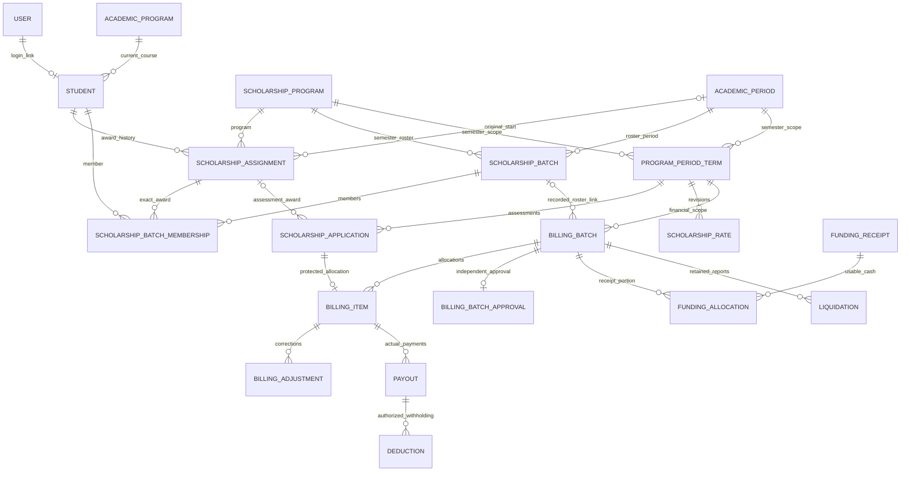
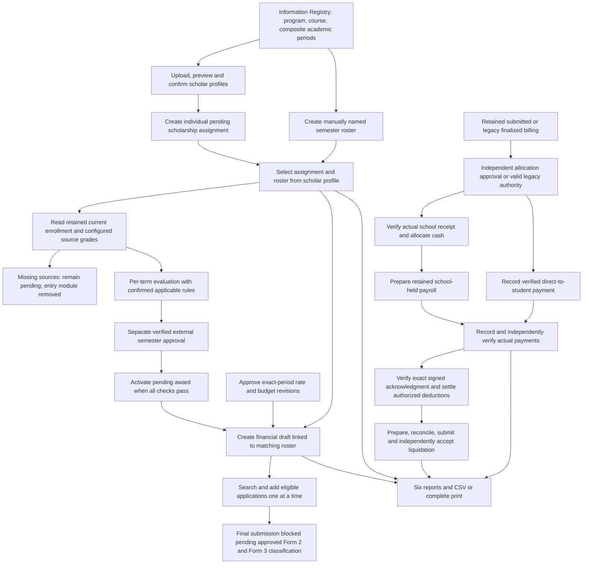
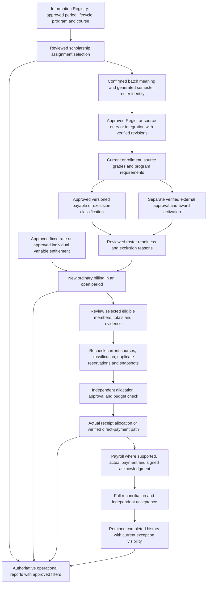

# Adviser workflow review and gap analysis

Date: 2026-11-19 (Asia/Manila)  
Source baseline: `09020e87c0b8da69518344b580c76ae6046e544b`  
**AUDIT COMPLETED — IMPLEMENTATION PENDING**

## 1. Executive summary

The current system already contains reusable scholarship registries, scholar bulk
upload, individual scholarship assignment, independent semester roster membership,
roster-linked billing drafts, versioned semester rates/budgets, independently
approved allocations, actual receipts/payments, retained payroll, signed-payment
verification, liquidation and six operational reports. It should not be rebuilt.

The end-to-end ordinary new-scholar billing workflow is not complete:

1. Final submission deliberately rejects every new batch until approved Form 2/Form 3
   templates and revision-traceable payable classification exist. This is a visible,
   intentional safeguard, not a newly discovered authorization bypass.
2. Academic record entry/verification was explicitly removed in an earlier request.
   Evaluations retain academic checks and read-only history but have no approved
   replacement source-entry path. Missing new enrollment/grades remain pending.
3. Closing an academic period does **not** prevent ordinary billing draft creation.
   This is a confirmed source-level mismatch with the new adviser requirement.
4. The requested automatic **roster** name is absent. Automatic `Batch N` numbering
   belongs to **BillingBatch**, a different entity. No automatic-roster-naming report
   was found in the current documentation inventory.
5. Bulk scholarship assignment, initial variable EDUKAR entitlement handling, a
   separate delisting-reasons registry, persistent semester exclusions and several
   requested report filters are not delivered as complete workflows.
6. Coordinator permissions are global by role. A per-program ownership policy has
   not been established in the reviewed approval records; global access must not be
   called a confirmed security defect without that rule.

The first bounded implementation task should enforce the existing `is_open` flag
for **new ordinary billing creation**, in both choices and the locked service path,
while retaining historical reads and grading sources. In parallel, obtain the
academic-source replacement decision and approved classification requirements:
they are prerequisites for completing a normal end-to-end workflow.

This is a static audit, not a functional acceptance verdict. Only this report was
created. No application code, tests, records or schema were changed; no application,
test suite, browser, build, migration or database query was executed during the audit.

## 2. Audit basis, adviser recommendations and documentation reconciliation

The attached request is the adviser recommendation set: complete the Information
Registry, reduce repeated scholar/amount selection, carry assignments forward across
semesters, distinguish roster membership from payable billing, simplify worklists,
retain financial history and improve reporting with approved role boundaries.
The requirement matrix below maps all those areas to current source evidence.

Reviewed implementation reports and relevant amendments:

- `docs/steps/08-implementation-gap-analysis.md`,
  `docs/steps/09-final-system-readiness-audit.md`,
  `docs/sms/bpm-coverage-and-testing-report.md`,
  `docs/sms/billing-roster-integration.md`, `docs/sms/billing-batches.md` and
  `docs/sms/confirmed-allocation-policy.md`.
- `docs/15-student-role-implementation.md`, the provisioning/lifecycle design and
  implementation references, and `docs/24-student-profile-editing.md`.
- `docs/16-bulk-scholar-upload-implementation.md` and
  `docs/17-bulk-upload-template-compatibility-fix.md`.
- `docs/19-academic-grade-computation-and-validation.md`, the subject UI report,
  `docs/21-academic-policy-conditional-validation-fix.md` and
  `docs/22-scholarship-evaluation-ui-improvement.md`.
- `docs/23-menu-restructuring-and-registry-integration.md`,
  `docs/24-academic-verification-module-removal.md`,
  `docs/24-system-wide-data-table-ui-improvement.md` and
  `docs/25-scholarship-batches-ui-improvement.md`.

Important reconciliations with current code:

| Historical statement | Current source conclusion |
| --- | --- |
| Earlier readiness audit HI-01 says billing does not persist/enforce its roster link | Superseded: `ManageBillingBatch::create` persists it; `BillingRoster` checks exact membership on add and submission. |
| Earlier CR-01 says school grading always returns review | Superseded in part: current `SchoolGradingPolicy` can pass confirmed program-period requirements with verified complete sources; official GWA inclusion/rounding and unavailable program rules still require confirmation. |
| Earlier academic documentation describes entry/verify/correct pages | Superseded by explicit removal; retained computations/policies do not create an operational entry route. |
| Earlier Student role is read-only / all creation depends on email | Later code supports allowlisted own-information editing and account management; do not use the older summaries as current UI inventory. No real delivery claim is made here. |
| Automatic billing numbers imply automatic roster names | Incorrect inference: current roster creation still accepts a manual name. |
| Old successful test totals prove current readiness | Not accepted. They refer to earlier source; some current tests still name removed routes. No tests were executed in this audit. |

No populated workbook, credential inventory, `.env`, live account membership or real
student data was opened. Official external policy links in source were not fetched:
this review evaluates the repository's recorded rules, not external legal/policy currency.

## 3. Existing module inventory and evidence catalog

Evidence references below are repository-relative **file:line** locations at the
baseline above. Ranges identify relevant adjacent source; no runtime behavior is
claimed solely because a component exists.

| Evidence | Current implementation / source anchors |
| --- | --- |
| E01 — Routes/navigation | `routes/web.php:31-61,89-143`; `resources/views/layouts/navigation.blade.php:1-59`. Authenticated horizontal menu; registry aliases and permission checks. |
| E02 — Scholarship programs | `app/Http/Controllers/ScholarshipProgramController.php:23-93`; `app/Http/Requests/ScholarshipProgramRequest.php:30-48`; `resources/views/programs/form.blade.php:1-24`. CRUD without delete, stable code, availability/reference amount. |
| E03 — Course registry | `app/Http/Controllers/AcademicProgramController.php:17-50`; `resources/views/academic-programs/index.blade.php:1-35`; `app/Models/Student.php:24-26,49-57`. Course availability and linked-profile name protection. |
| E04 — Academic periods | `app/Http/Controllers/AcademicPeriodController.php:20-108`; `app/Http/Requests/AcademicPeriodRequest.php:33-45`; `resources/views/periods/form.blade.php:5-11`; `app/Models/AcademicPeriod.php:10-48`. Combined year/semester identity, dates, open flag, in-use identity protection. |
| E05 — Active/source context | `app/Http/Requests/AcademicContextRequest.php:16-23`; `app/Http/Controllers/AcademicPeriodController.php:40-58`; `app/Actions/Eligibility/EvaluateApplication.php:35-72`. Explicit active/source periods and policy reference; latest verified source only. |
| E06 — Scholar registry/import | `app/Http/Controllers/ScholarController.php:25-99`; `app/Services/Records/ScholarImports.php:22-154`; `routes/web.php:117-127`. Search/filter/edit, owner-bound preview/confirm import, atomic profiles/audit. |
| E07 — Assignment | `app/Http/Requests/ScholarshipAssignmentRequest.php:20-38`; `app/Actions/Records/SaveScholarshipAssignment.php:21-83`; `app/Models/ScholarshipAssignment.php:14-36,78-105`; `resources/views/assignments/form.blade.php:7-20`. Individual pending assignment, original program/start retained, terminal history, single active award. |
| E08 — Roster | `app/Actions/Records/ManageScholarshipRoster.php:21-97`; `app/Models/ScholarshipBatch.php:9-30`; `app/Models/ScholarshipBatchMembership.php:10-35`; `resources/views/scholars/show.blade.php:7-15`; `resources/views/scholarship-batches/show.blade.php:4-18`. Independent membership and period coverage. |
| E09 — Batch modal | `resources/views/scholarship-batches/index.blade.php:1-33`; `resources/views/components/record-form-dialog.blade.php:1-21`; `resources/js/record-form-dialog.js:1-100`; `app/Http/Controllers/ScholarshipBatchController.php:35-56`. Authorized header action, retained fields, named-error recovery. |
| E10 — Roster DB constraints | `database/migrations/2026_11_13_000009_add_independent_scholarship_rosters.php:12-54`. Scoped unique roster names, composite membership FKs, unique student per roster, optional billing FK, scope and immutable-history triggers. |
| E11 — Billing creation/choices | `app/Http/Controllers/BillingBatchController.php:56-73,148-170`; `app/Actions/Billing/ManageBillingBatch.php:60-100`; `app/Services/Billing/BillingBatchOptions.php:11-65`. Scope, rate, roster, automatic financial numbering; no open-period guard. |
| E12 — Billing items/submission | `app/Actions/Billing/ManageBillingBatch.php:103-181`; `app/Services/Billing/BillingRoster.php:13-38`; `app/Http/Controllers/BillingBatchController.php:76-108`. Exact member applications, one-at-a-time add/remove, revalidation, final classification block. |
| E13 — Billing eligibility | `app/Services/Billing/BillingEligibility.php:18-93`. Approved rate, optional individual ceiling, active assignment/student/program, period coverage, current evaluation, verified exact-semester external approval and evidence. |
| E14 — Evaluation/activation | `app/Actions/Eligibility/EvaluateApplication.php:25-95`; `app/Actions/Eligibility/ActivateAward.php:23-68`; `app/Models/ScholarshipApplication.php:77-81`; `app/Http/Controllers/ScholarshipEvaluationController.php:62-93,96-126,129-228`. Immutable runs, current decision, external evidence and activation safeguards. |
| E15 — Academic calculations/policy | `app/Services/Eligibility/AcademicGradeComputation.php:38-89,119-171`; `app/Services/Eligibility/SchoolGradingPolicy.php:9-71`; `app/Http/Controllers/AcademicRequirementController.php:19-58`; `app/Services/Eligibility/OfficialRuleCatalog.php:35-58`; `app/Services/Eligibility/EligibilityEvaluator.php:17-32`. Percentage arithmetic, review cases, configurable requirements, limited official-rule coverage. |
| E16 — Academic source boundary | `routes/web.php:103-116`; `app/Actions/Records/SaveAcademicVerification.php:21-92`; `resources/views/evaluations/partials/academic-records.blade.php:1-8`; `resources/views/components/retained-academic-source.blade.php:1-10`. Action retained, entry routes absent, sources/certificates read-only. |
| E17 — Financial approval/adjustment | `app/Actions/Billing/ManageBillingBatch.php:28-57`; `app/Actions/Billing/ManageScholarshipFunds.php:24-130`; `app/Models/BillingBatch.php:123-141`; `app/Models/BillingItem.php:99-101`; `app/Services/Billing/AllocationSummary.php:12-33`. Versioned rates/budgets, separate approval, adjustment ledger and derived totals. |
| E18 — Financial UI | `resources/views/billing/index.blade.php:1-76`; `resources/views/billing/show.blade.php:14-55`; `app/Http/Controllers/FinancialRecordController.php:28-69`; `resources/views/financial/index.blade.php:1-18`; `resources/views/financial/batch.blade.php:3-28`. Existing filters/worklists/forms and stages. |
| E19 — Actual money/payroll | `app/Actions/Billing/RecordFinancialActivity.php:31-143,185-258`; `app/Actions/Billing/PreparePayroll.php:28-126`; `app/Services/Billing/BatchFundingStatus.php:13-82`. Receipts versus allocations/payments, exact cash caps, independent posting, computed stages. |
| E20 — Liquidation/signatures | `app/Actions/Billing/ManageLiquidation.php:19-113`; `app/Services/Billing/LiquidationSummary.php:14-151`; `app/Actions/Billing/VerifyPaymentAcknowledgment.php:24-79`; `app/Services/Billing/SignedAcknowledgment.php:15-34`. Retained acknowledgments, exact coverage, full reconciliation, independent acceptance. |
| E21 — Reports | `app/Http/Controllers/ScholarshipReportController.php:18-75,78-123`; `app/Services/Reporting/ScholarshipReports.php:21-59,64-96,135-172,181-304`; `resources/views/scholarship-reports/index.blade.php:20-38`; `app/Http/Controllers/ScholarshipFundsController.php:55-90`. Six modes, scoped filters, CSV/complete print and allocation summaries. |
| E22 — RBAC/authentication | `app/Models/User.php:18-27,37-65,86-100`; `app/Models/UserRole.php:10-18`; `app/Policies/RecordPolicy.php:10-34`; `app/Policies/BillingBatchPolicy.php:10-48`; `app/Policies/FinancialRecordPolicy.php:9-26`; `app/Policies/ScholarshipBatchPolicy.php:9-12`; `app/Policies/ScholarshipApplicationPolicy.php:10-27`; `app/Http/Requests/FinancialRecordRequest.php:11-17`; `app/Http/Requests/Auth/LoginRequest.php:42-86`; `app/Http/Controllers/Auth/AuthenticatedSessionController.php:29-45`. Role gates, hashing, throttling and session regeneration. |
| E23 — Student boundary | `app/Http/Controllers/StudentProfileController.php:18-61`; `app/Policies/StudentPolicy.php:13-31`; `app/Http/Requests/StudentProfileUpdateRequest.php:13-45`; `app/Actions/Records/UpdateOwnStudentProfile.php:19-119`; `app/Services/Accounts/StudentAccess.php:13-58`; `app/Http/Middleware/EnsureStudentAccess.php:12-26`; `app/Actions/Accounts/LinkStudentAccount.php:146-238`; `app/Policies/StudentAccountProvisioningPolicy.php:10-23`. Own-profile allowlist, lifecycle checks, canonical role repair and protected provisioning. |
| E24 — Table/navigation presentation | `resources/js/data-tables.js:1,74-126,195-250`; `resources/css/app.css:1051-1095`; `resources/js/primary-navigation.js:19-63,102-160`. Onchange size above table, independent viewport/sticky header, outside count/pager, hover/touch/keyboard navigation. |
| E25 — Historic/schema integrity | `database/migrations/2026_11_11_000000_create_scholarship_foundation_tables.php:80-97,125-145,201-243,246-272`; `database/migrations/2026_11_11_000005_add_semester_billing_management.php:41-56`; `database/migrations/2026_11_11_000006_add_scholarship_allocation_approvals.php:16-25,38-68,78-84`; `database/migrations/2026_11_12_000008_add_financial_recording_workflows.php:42-58`. Scope FKs, unique awards/bills and immutable approval/history. |
| E26 — Obsolete test references | `tests/Feature/Auth/OperationalRoleSecurityTest.php:39,102`; `tests/Feature/Integration/ScholarshipLifecycleTest.php:106-119`; `tests/Feature/Records/AcademicVerificationTest.php:74,92-93`, compared with current `routes/web.php:103-116`. Removed route names still referenced; source inspected only. |

## 4. Entity relationships and responsibilities

| Business term | Actual entity / responsibility |
| --- | --- |
| Scholarship program | `scholarship_programs`: grant identity, reference amount, availability; not a bill or student award. |
| Scholarship assignment | `scholarship_assignments`: one scholar's program award, original starting period/dates, status and activation/closure provenance; can span semesters. |
| Scholarship batch | In this checkout, `scholarship_batches` is a program-and-period **semester roster header**, not a separately modeled admission/cohort award batch. |
| Semester roster | The same header plus `scholarship_batch_memberships`, which link exact student/assignment/program/period. No amount, eligibility decision or payment is implied. |
| Billing batch | `billing_batches`: a separately numbered financial submission linked to one roster and one program/period term/rate. One roster can have multiple submissions; one student/period allocation is still globally protected. |
| Semester assessment | `scholarship_applications` plus immutable evaluation runs and external approvals: per-term validation of an assignment, not a new assignment each semester. |

An assignment does not store `scholarship_batch_id`. A membership references the
assignment instead. There is no existing independent long-term cohort/batch FK
whose meaning can safely be assumed from the adviser's wording (E07–E12, E25).

Nullable relationships shown above preserve legacy records; current creation rules
can be stricter than nullable historical schema. Roster and membership update/delete
triggers reject rewriting history. Future naming/cohort/correction work must account
for those constraints rather than renaming all retained headers.

## 5. Detailed recommendation matrix

Statuses describe source implementation, never executed test results. Priorities:
**P0** blocks the ordinary complete workflow; **P1** integrity/security or major
missing capability; **P2** usability/completeness; **P3** maintenance/documentation.
Evidence IDs resolve to exact paths/lines in section 3. Matrices A and B join by ID;
together each recommendation includes implementation, evidence, status, gap,
priority, correction, reuse, business clarification and dependencies.

### A. Requirement, current implementation and gap

| ID | Adviser requirement | Current implementation / source evidence | Status | Confirmed defect or missing requirement | Priority |
| --- | --- | --- | --- | --- | --- |
| R01 | Manage Scholarship Grant / Program | E02: stable code/name, reference amount, availability and history. | IMPLEMENTED | No rebuild needed. | P2 |
| R02 | Batch and Roster registry responsibilities | E01/E08/E10: two menu aliases to one semester roster entity. | REQUIRES BUSINESS RULE CONFIRMATION | Separate long-term cohort meaning not defined. | P1 |
| R03 | Course / Program management | E03: create/status controls and existing-name protection. | IMPLEMENTED | Retains list layout and 15-row paging. | P2 |
| R04 | Scholars registry and bulk registration | E06: search/filter/edit and preview/confirm profile import. | IMPLEMENTED | Import creates profiles only, not awards/accounts. | P2 |
| R05 | Separate Academic Year / Semester responsibilities | E01/E04: same controller, composite period model and screen. | PARTIALLY IMPLEMENTED | Labels are separate; management responsibilities are not. | P2 |
| R06 | Manage active/inactive academic periods | E04: explicit Open/Closed control and in-use identity protection. | IMPLEMENTED | `is_open` is not a universal activity state. | P2 |
| R07 | Exclude inactive periods from new ordinary billing | E11: all periods in choices; request validates existence; locked creation does not inspect `is_open`. | DEFECT IDENTIFIED | D01: closed-period draft creation is not rejected. | P1 |
| R08 | Keep historical periods available for sources/reports | E04/E05/E21: unfiltered historical choices, explicit source confirmation. | IMPLEMENTED | Must not solve R07 by globally hiding closed periods. | P1 |
| R09 | Approved first/second/summer/mid-year types | E04/E15: free-text normalized code; rule applicability only `1`/`2` from 2026 onward; custom ordering needs dates. | REQUIRES BUSINESS RULE CONFIRMATION | Storage accepts custom labels; complete approved type/policy mapping absent. | P1 |
| R10 | Reason for Delisting registry | E01/E07: disabled navigation item, assignment reason text. | NOT IMPLEMENTED | No separate registry/model/route; user previously chose unavailable display. | P2 |
| A01 | Assignment program, start year/semester/date/status | E07: program, composite starting period, optional start date and statuses. | IMPLEMENTED | Starting year/semester derive from one period, not duplicate fields. | P2 |
| A02 | Assignment scholarship batch | E07/E08: indirect roster membership; no award/cohort batch field. | REQUIRES BUSINESS RULE CONFIRMATION | Cohort versus semester roster ownership unresolved. | P1 |
| A03 | Bulk assign selected scholars | E06/E07 and `routes/web.php:131-142`: individual assignment only. | NOT IMPLEMENTED | Profile bulk upload is not bulk scholarship assignment. | P1 |
| A04 | Prevent duplicates and unauthorized activation | E07/E14/E25: locked duplicate pending/active same-start check, global single-active unique slot, evaluation/external activation. | IMPLEMENTED | No removal of these checks justified. | P1 |
| A05 | Continue original assignment across semesters | E08: coverage bounds; E13: target may be later than start. New assessment per term. | IMPLEMENTED | Continuing roster/application selection is manual. | P1 |
| A06 | Billing independent of original start semester | E13: range coverage, not exact start equality; E14: assessment uses current active period. | IMPLEMENTED | Target-term approval/evaluation/rate still required. | P1 |
| B01 | Automatic roster name `{Program}-{Batch Number}-{Semester}-{Academic Year}` | E08/E09: manual name; E11: `Batch N` belongs to billing; no roster generator/report found. | NOT IMPLEMENTED | Requested format is absent on roster entity. | P2 |
| B02 | Membership selection, clear assigned scholars, duplicates | E08/E10: scholar-centric add, roster list/findings, unique member constraint. | PARTIALLY IMPLEMENTED | No multi-scholar selection workspace or already-assigned selection indicator. | P2 |
| B03 | Continuing scholars in next semester roster | E08: same pending/active assignment can join a covered later roster. | PARTIALLY IMPLEMENTED | No reviewed carry-forward/bulk selection action. | P2 |
| V01 | Billing fetches the selected roster | E11/E12: persisted matching roster link and member-limited candidate applications. | IMPLEMENTED | Earlier HI-01 link defect is corrected in source. | P1 |
| V02 | Avoid repeated scholar entry/selection | E12/E18: names/IDs reused, but each eligible candidate added separately after an assessment exists. | PARTIALLY IMPLEMENTED | No reviewed bulk add from roster; no new identity entry is required. | P2 |
| V03 | Current enrollment, academics, evaluation, assignment and approval | E13–E16: full gates retained; source entry removed. | PARTIALLY IMPLEMENTED | G01: no current source-entry path for missing new records. | P0 |
| V04 | Payable Form 2/Form 3 classification and final submission | E12: unconditional validation exception before submitted header save. | NOT IMPLEMENTED | G02: approved classifier/templates absent; fail-closed block is intentional. | P0 |
| V05 | Duplicate ordinary billing versus legitimate correction | E12/E17/E25: global student/period reservation; approved adjustments on existing item. | IMPLEMENTED | Separate duplicate bills are prohibited; adjustments are supported. | P1 |
| V06 | Cancelled drafts release availability safely | E12: authorized draft-item removal releases reservation; no header cancel/void operation in routes/actions. | PARTIALLY IMPLEMENTED | No cancellation lifecycle; retained items reserve even if history says void. | P1 |
| S01 | Pending/active/closed/relinquished historical meaning | E07/E25: pending/active/ended/suspended stored; relinquished encoded as ended plus closure reason. | IMPLEMENTED | Suspended is historical/read-only in current UI; no arbitrary status rewrite. | P1 |
| S02 | Simplify status presentation | E07/E18: labels exist but program/assignment/profile/account/billing states remain separate. | PARTIALLY IMPLEMENTED | Consolidated explanatory summary could reduce confusion. | P2 |
| S03 | Temporary semester exclusion distinct from termination | E08/E12/E15: findings block payability without closing assignment; no explicit period exclusion ledger. | PARTIALLY IMPLEMENTED | Persisted exclusion/reason/review lifecycle absent. | P1 |
| S04 | No automatic delisting for failed/INC/dropped | E15: review status, special-grade preservation, no assignment mutation. | IMPLEMENTED | Manual/approved policy needed to end an award. | P1 |
| F01 | Authoritative approved fixed rates retrieved automatically | E11/E13/E17: latest approved rate on new batch, pinned snapshot on bill; configurable reference only. | IMPLEMENTED | Applies uniformly; no official rates should be inferred from reference. | P1 |
| F02 | Remove redundant amount entry without losing approval | E18: reference amount prefill and separate approval, revision and budget forms. E19: actual cash facts separate. | PARTIALLY IMPLEMENTED | Billing landing page mixes setup and transaction tasks; authority steps are not redundant data. | P2 |
| F03 | Fixed TDP/TES/CoScho versus variable EDUKAR funding | E13: one semester rate supplies every initial bill; individual amount is only a ceiling; E15: EDUKAR always review, CoScho has no catalog policy. | REQUIRES BUSINESS RULE CONFIRMATION | No approved variable calculation/initial entitlement workflow or complete CoScho/EDUKAR eligibility policy. | P0 |
| F04 | Preserve historical financial snapshots/adjustments | E17/E25: versioned rate/budget, original bill, approval snapshot and adjustment records. | IMPLEMENTED | Do not replace historical rate IDs/amounts or re-enter approved records. | P1 |
| U01 | Top billing creation action and simplified layout | E18: creation card follows tables; header has report/stages links. | PARTIALLY IMPLEMENTED | Top primary creation action absent on Billing; roster modal does not change Billing. | P2 |
| U02 | Filters, scrolling, sort, counts, page-size, pagination | E18/E24: shared enhancement and separate table states. | IMPLEMENTED | Static source only; visual behavior still needs developer verification. | P2 |
| U03 | Clear roster selection, validation/confirmation, pending/completed records | E12/E18: matching choices, per-candidate reasons and confirmation form; classification notice blocks progression; stages/status views exist. | PARTIALLY IMPLEMENTED | Unified readiness summary and active/history worklists absent. | P2 |
| P01 | Separate institution receipts from scholar payments | E19: posted receipt → allocation → school payout; direct payout never becomes school cash. | IMPLEMENTED | System records external transactions; it sends no money. | P1 |
| P02 | Payment/deduction/balance/payroll/liquidation safeguards | E19/E20: draft/posted, cash caps, gross/net reconciliation, retained payroll, signature and independent acceptance. | IMPLEMENTED | Full normal entry flow still depends on G01/G02. | P1 |
| P03 | Keep paid/liquidated history out of inappropriate active worklists | E18: financial index selects all submitted/finalized; E19 stages distinguish applied; liquidation acceptance separate. | PARTIALLY IMPLEMENTED | No default outstanding/accepted-history split; applied is not the same as liquidated. | P2 |
| P04 | Refund/return/reallocation/correction workflow | E19/E20: reversal metadata/read checks exist, but no operational refund/return routes; mismatched cash blocks liquidation. | REQUIRES BUSINESS RULE CONFIRMATION | No approved full cash correction workflow; do not delete or edit posted history. | P1 |
| T01 | Operational reports, authoritative totals/CSV/print | E21: six modes, source evidence, deduplicated totals, exception disclosures and exports. | IMPLEMENTED | Internal reports are not approved provider filing templates/as-of reconstructions. | P1 |
| T02 | Filter program, batch, academic year and semester | E21: program, roster/billing IDs, year, semester/exact period and compatibility validation. | IMPLEMENTED | Batch means recorded roster or billing link, not undefined cohort. | P2 |
| T03 | Course, scholar, billing, payment and liquidation status report filters | E21: no such report inputs or corresponding query conditions; mode/stage views cover only part of the need. | NOT IMPLEMENTED | Modes are not independent status filters; Course missing. | P2 |
| X01 | Actual role responsibilities and backend authorization | E22/E23: role-string memberships, gates/policies/action checks, CSRF and private views. | IMPLEMENTED | Registrar/Coordinator operational; Test Administrator exception; Finance/Viewer legacy. | P1 |
| X02 | Coordinator access scoped to own programs/batches | E22: no program membership field/scope; all records by role. | REQUIRES BUSINESS RULE CONFIRMATION | Global scope confirmed; inappropriate access not confirmed without ownership policy. | P1 |
| X03 | Hashed passwords, Student ownership/lifecycle, no escalation | E22/E23: hashed cast, password checks/rate limit, own relation/allowlist, canonical role fix, status/session checks. | IMPLEMENTED | Static controls found; no fresh login/security execution or credential delivery verification. | P1 |
| X04 | Regression readiness against latest routes | E26: existing tests call removed academic routes. | DEFECT IDENTIFIED | D02: stale test contracts; historical passing totals cannot certify this checkout. | P1 |

### B. Correction, existing reuse, business decisions and dependencies

`None` means no additional business decision is necessary for the narrow retained
capability, not that its runtime behavior has been tested. Q references resolve in
section 10.

| ID | Recommended correction / retention | Existing functionality to reuse | Required business clarification | Dependencies |
| --- | --- | --- | --- | --- |
| R01 | Retain current registry; simplify its optional financial context only if needed. | Program CRUD/audit. | None. | Developer regression review. |
| R02 | Define cohort versus semester roster before adding any entity. | Existing roster/membership FKs. | Q1. | A02/B01. |
| R03 | Retain availability and linked-name safeguards. | AcademicProgram controller/list. | None. | Manual verification. |
| R04 | Retain atomic import, validation and existing profile workflow. | ScholarImports, shared profile validation. | None. | Workbook validation remains developer-owned. |
| R05 | Use distinct views/responsibilities over existing composite periods if approved; no duplicate year data by default. | AcademicPeriod controller/request. | Q2. | R09. |
| R06 | Retain open/closed management; explain it separately from active validation context. | Existing `is_open`/context. | Q2 for broader lifecycle semantics. | R07. |
| R07 | Filter only new-billing choices; reject closed periods in locked creation path. | Existing period field, choices and service transaction. | Q3 only for exceptions/existing drafts; ordinary-new rule is explicit. | Preserve R08; no schema needed. |
| R08 | Keep closed periods readable/selectable as approved historic sources. | Existing report/history/source choices. | Source policy approval where required. | R07 must use separate lists. |
| R09 | Add only approved type/order/applicability mapping; retain safe review for unknowns. | Free-text storage/date bounds/catalog applicability. | Q4. | Institutional calendar and program policy. |
| R10 | Keep unavailable until registry scope is approved; later reference versioned reasons without rewriting history. | Existing free-text closure reason/audit. | Q5; prior unavailable choice remains. | S03/status policy. |
| A01 | Retain field names, optional exact date and composite period reference. | SaveScholarshipAssignment. | None. | A04 safeguards. |
| A02 | Link an approved cohort only if distinct; otherwise explain semester memberships. | Existing assignment/membership relations. | Q1. | R02. |
| A03 | Add explicit reviewed multi-scholar selection and transactional outcomes, preserving individual checks. | SaveScholarshipAssignment and scholar filters. | Q6 atomicity/selection semantics. | A04; approved cohort meaning if included. |
| A04 | Retain locked duplicate prevention and evaluated activation; never mass-activate by assignment alone. | Existing action/policy/generated unique slot. | None for existing rule. | Correct sources and external approvals. |
| A05 | Improve eligible continuation selection, reusing original assignment IDs. | Period coverage and per-term assessment creation. | Q6 for carry-forward interaction. | B03/V03/V04. |
| A06 | Keep range-based coverage and exact target-term checks. | BillingEligibility and roster `covers`. | Q4 for special-term chronology. | R09. |
| B01 | Implement naming on confirmed roster owner with collision-safe sequence and immutable historic names. | Roster creation locks/unique scope/modal. | Q1/Q7. | No global rename; forward-only schema if needed after design. |
| B02 | Add reviewed membership selection showing existing members without removing guards. | Scholar roster add/action and unique constraint. | Q6 membership overlap/correction policy. | A03/B03. |
| B03 | Offer selection of covered continuing assignments; no automatic qualification. | `covers`, existing memberships and assessment action. | Q6. | A05/V03. |
| V01 | Retain current linked-draft and membership enforcement. | BillingRoster, existing FK/scope triggers. | None. | V04 before submission completion. |
| V02 | Provide reviewed bulk-add eligible candidates; explain excluded members. | Candidate query, BillingEligibility and locked add operation. | Q6 mixed valid/invalid outcomes. | V03/V04/F03. |
| V03 | Agree replacement Registrar source ingestion/verification boundary; reuse revision history rather than restoring removed module silently. | SaveAcademicVerification, policies/private certificates. | Q8. | Approved data source; current policy storage. |
| V04 | Implement approved template/version/current classification and recheck at submit. | BillingRoster guard, evaluation sources, transactions and snapshots. | Q9. | Q8, official forms and exclusion policy. |
| V05 | Keep one ordinary allocation per student/period; correct through authorized adjustments. | Unique constraints, ManageScholarshipFunds. | Q10 only if true supplemental billing is requested. | Approved rates/budget/financial correction rules. |
| V06 | Design auditable draft cancellation/reservation release; retain existing safe draft-item removal meanwhile. | Draft policy/remove/version/audit. | Q10 cancellation versus retained reservation. | No changes to submitted history. |
| S01 | Retain exact stored states and closure provenance. | `statusLabel`, closure/audit protections. | Q5 for any new transition. | Status migration only if subsequently justified. |
| S02 | Group display labels while retaining distinct underlying states and reasons. | Existing badges/labels and snapshots. | Q5. | S01. |
| S03 | Add explicit period exclusion only after scope/reason/review decisions; never close assignment automatically. | Enrollment findings/evaluation/exclusion messaging. | Q5/Q9. | V04/R10. |
| S04 | Preserve review behavior and reported grades. | SchoolGradingPolicy and immutable sources. | Approved school criteria for any future adverse action. | None for retaining current behavior. |
| F01 | Keep approved exact-period rate lookup/pinning; no unverified reference copying. | ScholarshipRate and appliedRate/basis snapshots. | Applicable rate authorization remains required. | R07/F03. |
| F02 | Separate setup/revision/budget UI from ordinary billing; prefill approved context without suppressing approval. | Existing forms/controllers, modal pattern. | None for layout; Q11 for variable entitlement. | U01/F04. |
| F03 | Approve variable entitlement authority/formula and program eligibility, then extend existing initial amount path. | Existing entitlement columns, rate/basis snapshots and adjustment ledger. | Q11 plus Q8/Q9; no invented rates/formula. | Policy approval before code, evidence and migration review if needed. |
| F04 | Preserve original bill/approval/rate; append reviewed changes only. | Rate/budget revisions and adjustments. | None for existing safeguards. | All financial changes. |
| U01 | Add authorized top creation action using existing create endpoint; move setup to suitable disclosures/pages. | Existing dialog/form patterns and billing controller. | None for targeted layout. | R07/V02 readiness context. |
| U02 | Retain shared table utilities and separate page state. | Shared JS/CSS/TablePagination. | None. | Developer visual verification. |
| U03 | Summarize roster counts/readiness, blockers and decision stages without implying payability. | Existing candidate reasons, classification notice, stage service. | Q9 for payable definition. | V04/P03. |
| P01 | Retain separate receipt, allocation and actual payment ledgers. | RecordFinancialActivity. | None for current paths. | Evidence/independent verifier. |
| P02 | Retain full safeguards, signature verification and independent liquidation acceptance. | PreparePayroll, LiquidationSummary and actions. | Q12 for provider/direct extensions. | Valid existing submitted/approved records. |
| P03 | Derive active/history tabs from payment outstanding and accepted-liquidation/current-exception state. | BatchFundingStatus plus liquidation relations/checks. | Q12 default worklist semantics. | No relocation/deletion of records. |
| P04 | Design approved corrective entries for actual cash, never ledger edits or guessed refunds. | Reversal metadata, limits, history and reconciliation checks. | Q10/Q12. | Accounting/provider authority and correction acceptance criteria. |
| T01 | Retain existing authoritative reports/CSV/print; optimize large reads later without page-only totals. | ScholarshipReports, existing summary services. | Q13 for official filing/as-of scope. | Reverification after new filters/workflows. |
| T02 | Retain compatible recorded-link/year/semester filtering including unlinked history. | validateScope and existing source queries. | Q1 for cohort terminology. | No inferred historical links. |
| T03 | Add course and approved state filters to HTML/CSV/print with consistent totals/denominators. | Existing report controller/query builder/modes. | Q13 current versus historic course/status and roster denominator. | P03/status vocabulary approved first. |
| X01 | Retain existing gates, actor checks, ownership and independent approvals. | Existing policies/requests/services. | Q14 if operational Finance is reintroduced. | No new role assignment UI. |
| X02 | Confirm global versus assigned-program scope; if restricted, enforce queries/actions/exports consistently. | Role architecture/policies, possible future membership relation. | Q14. | Approved ownership model and historical exceptions. |
| X03 | Retain hash/ownership/lifecycle checks; verify through isolated execution only when later authorized. | Existing authentication/provisioning/SR-01 services. | Credential delivery/initial-password policy is separate; no secrets disclosed here. | Appropriate isolated accounts/database. |
| X04 | Update obsolete route assertions to approved retained/new source boundary in a later verification task. | Existing security/integration suites. | Q8 informs new source-entry scenarios. | Explicit authorization to change/run tests; isolated MySQL/MariaDB. |

## 6. Confirmed defects, missing functionality and source-derived consequences

### D01 — Closed academic period does not constrain ordinary new billing

**Evidence:** E04/E11. `BillingBatchController::choices` at lines 165–170 returns
all periods, `scopeRules` at line 150 checks only existence, and
`ManageBillingBatch::create` at lines 67–74 locks the selected period without
checking `is_open`. A static search of `app`, `routes` and migrations found `is_open`
only in period storage/validation/display/default creation; no ordinary billing gate.

**Source-derived scenario, not executed:** an authorized preparer selects an
existing closed period with a matching roster and configured rate. Closed status
alone causes no rejection in the current draft-creation path. The permanent final
classification stop still applies later; this finding does not claim a closed-period
batch was successfully submitted or funded.

**Correction:** filter open periods only in ordinary new-billing choices and
check the locked period in the shared creation action. Keep separate unfiltered
choices for historical billing/reporting/approved grading sources. Clarify existing
drafts or retrospective exceptions rather than inventing rules for them. No new
table or global historical rewrite is required for the narrow defect.

### D02 — Existing test contracts refer to removed application routes

**Evidence:** E26, with current routes E01/E16. Security and lifecycle tests still
construct `academic-verifications.index/store/show/certificate` route names, while
those routes are absent. The current read-only certificate name is
`academic-certificates.download`.

This is a confirmed source-contract inconsistency, not an observed test-run
failure. Executing affected route construction would require routes that current
source does not define; no failure totals are invented. The intentional module
removal must not be reversed just to satisfy obsolete assertions. Align those
scenarios with the approved source boundary and preserve meaningful denial/history
coverage when test work is subsequently authorized.

### Missing or incomplete capabilities, not falsely classified as security defects

- **Academic source ingress (P0):** internal action/policies remain, but no public
  record creation/verification/correction workflow calls them. This is an intentional
  prior scope removal with an unresolved replacement dependency (E16).
- **Final classification (P0):** `BillingRoster::submissionClassification` always
  throws. The call occurs inside the transaction after tentative item finalization,
  so the exception rolls those updates/audits back. Removing the call is not a fix
  (E12). No separate Form 2/Form 3 classifier was found in operational source.
- **Program coverage (P0 where required):** catalog policies exist for TES/TDP only;
  CoScho and other program codes return null. EDUKAR explicitly remains review.
  Configurable academic requirements alone cannot replace those absent official
  application/eligibility rules (E15).
- **Batch identity/naming:** roster name is a manual string with a scoped unique
  constraint. Billing numeric sequencing and filter-label formatting do not satisfy
  the requested roster naming convention (E08/E09/E11).
- **Batch operations:** roster index/store/show/join exist, with immutable roster
  headers/memberships; roster editing/status/removal do not currently exist. Billing
  draft edit/remove is a separate workflow (E01/E10/E12).
- **Cancelled drafts:** only removing a draft item releases its unique student/period
  reservation through an existing action. There is no ordinary header cancellation
  transition; calling something cancelled in the UI would not release rows. Voided
  or historical items still occupy the global unique key. Do not delete approved
  history to permit duplicate ordinary billing (E12/E25).
- **Initial variable entitlements:** the initial bill amount always comes from the
  approved semester rate. Existing individual authorization is a ceiling check, not
  the selected payable amount. No current staff route populates that authorization
  as a complete variable-award process. Later allocation adjustments are not an
  initial EDUKAR entitlement workflow (E13/E17).
- **Worklists/report filters:** stage summaries exist, but default lists mix pending
  and completed history, and requested course/status report filters are absent
  (E18–E21). These are usability/capability gaps, not proof of incorrect historical totals.

## 7. Financial amount source analysis

| Amount/fact | Authoritative current source | User entry / derived behavior | Retention / recommendation |
| --- | --- | --- | --- |
| Program reference | `scholarship_programs.school_stated_semester_amount` | Optional configurable planning/reference input. | Never authorizes a bill/payment. Preserve source notes. |
| Initial semester confirmation | `program_period_terms` billing-confirmed fields | First financial confirmation records policy/source/actor/time. | Retained initial confirmation, not silently overwritten by later rate revision. |
| Approved semester rate | Latest approved `scholarship_rates` revision in exact program/period | Initial form can prefill reference; explicit approval/reference still necessary. | New batch pins a rate ID; current reference changes do not rewrite old bills. |
| Individual ceiling | `scholarship_applications.approved_gross_amount` with authority/time/basis | If present, limits the uniform rate; absent means no separately entered ceiling. | Does not itself implement variable initial amount selection. |
| Original billing item | `billing_items.gross_amount`, entitlement and basis snapshots | Derived from approved pinned rate after eligibility checks; no per-item amount text entry on add. | Retain original, evaluator and external approval references. |
| Batch prepared total | `BillingBatch::totalAmount` | Integer-centavo sum of original item gross; null if a historical amount is unknown. | Not received money; separate effective total after adjustments. |
| Budget / remaining budget | Latest `scholarship_budgets` revision minus approved originals plus signed adjustments | Approved planning ceiling and derived remaining amount. | Not cash balance. Do not equate budget and expected receipts. |
| Effective allocation | Original item plus `billing_adjustments` | Authorized append-only increase/decrease with sequence/reference/reason. | Checked against budget/rate, posted payments and accepted liquidation. |
| Institution cash | Posted `funding_receipts`, then posted `funding_allocations` | Actual received amount/date/source, followed by the actual portion assigned to a batch. | Two distinct facts, not redundant rate entry. Evidence, caps and independent posting apply. |
| Prepared payroll | Retained `payroll_items` snapshots | Derived remaining gross after earlier posted payment; full approved batch funding required. | Plan only; does not create a payout or signature. |
| Actual student payment | Posted `payouts.gross_amount/net_amount` and payment path/evidence | Records actual external payment; direct has no school deduction/cash receipt. | Must not be replaced by a promised/reference rate. Independent verification. |
| Withholding/settlement | Specifically authorized `deductions`, then settlement evidence/date/reference | Gross = actual student net + authorized deductions. Withholding alone is not settled. | Full settlement and proof retained; partial settlement/cash returns are not implemented flows. |
| Liquidation | Frozen report lines/checklist over verified payments and settled deductions | Derived expected coverage and reconciled allocated school cash. | Full benefit coverage, signed proof, independent acceptance; later exceptions remain visible. |

Sources: E13/E17/E19/E20/E25. References are not new institutional amounts; no rate
or formula has been inferred. TDP/TES/CoScho are identified by the adviser as fixed
and EDUKAR as variable, but no `funding_type` selector or variable initial-payable
branch exists in the inspected models/services/migrations.

The strongest simplification is to separate rate/budget setup from routine billing
and show the already approved rate read-only on the selected scope. Preserve explicit
approval, actual receipt, receipt allocation and actual payout inputs: they represent
different authorities/events, even when their numbers happen to match.

## 8. AS-IS and proposed TO-BE workflows

### Actual current workflow

This diagram deliberately does not draw a working edge from the final-submission
stop into approval. Financial downstream services can handle retained eligible
history; their presence does not prove the normal new-record path is complete.

### Recommended workflow, subject to the listed business decisions

No automatic assignment activation, non-enrollment termination, eligibility bypass,
reference-rate approval, cash receipt or student payment should be introduced by
this proposed simplification.

## 9. Status, worklist, reporting and authorization conclusions

### Status distinctions

- **Assignment:** pending → active only through eligible evaluation/approval;
  pending/active may be closed. Stored ended with `closure_reason=relinquished`
  displays Relinquished. Suspended exists in schema but is not an editable current
  assignment transition. Closed/relinquished records remain history.
- **Scholar profile:** active/archived is separate; current staff archive action
  rejects archiving a scholar with an active assignment (E06).
- **Student login:** pending setup/enabled/inactive is separate from scholarship
  status and academic eligibility (E23).
- **Semester roster:** retained membership is not payability; latest verified
  not-enrolled finding does not remove the member or terminate the assignment.
- **Billing:** draft reserves a student/period once an item exists; submitted has
  provenance and finalized items; independent approval is a separate approval row.
  `allocationStatus()` presents it as approved without changing header status.
  Finalized is retained legacy authority; void is historical, not an exposed cancel action.
- **Funding/payment:** `awaiting_funds`, `funded`, `applied`, `review` are computed
  stages; payout draft/posted is a separate actual payment state. Fully applied can
  include authorized withholding and does not prove signed evidence/settlement.
- **Liquidation:** draft → submitted → accepted/returned, with retained versions,
  exact coverage and independent review. Accepted history can acquire a current
  evidence/source exception without its historical acceptance being rewritten.

Use readable grouped badges and separate active/history queries. Do not collapse
these independent facts into one irreversible “Active/Inactive/Paid” database flag.

### Report filter coverage

| Requested filter | Actual support |
| --- | --- |
| Scholarship program | Yes, all six report modes. |
| Batch | Recorded semester roster and financial billing submission IDs; no separate cohort. |
| Course / academic program | No report filter; current profile course exists elsewhere. |
| Academic year | Yes. |
| Semester | Yes, registered code; exact academic period also accepted. |
| Scholar status | No independent report filter; assignment/enrollment labels appear in roster output. |
| Billing status | No independent report filter; billed/not-billed modes enforce their own definitions. Billing index has separate status filtering. |
| Payment status | No general report filter; signed-paid/awaiting-funds modes are narrower source-defined reports. |
| Liquidation status | No general report filter; liquidated mode requires currently supported accepted history and discloses exceptions. |

Reports use roster membership, finalized submitted items, adjustments, posted
payments, signature evidence and current liquidation checks rather than a copied
student total. HTML totals and CSV/print describe the whole filtered result, not
only the current page. Builders currently materialize full result collections
before UI pagination; consider bounded query/aggregation work for large production
datasets, but no measured performance defect is asserted without execution.
Roster denominators must not silently become billing-only when adding financial filters.

### Actual roles

| Role | Current responsibilities and scope |
| --- | --- |
| Coordinator | Maintains programs/courses/periods and context, assignments/rosters, confirms rules, evaluates and records external decisions, prepares billing; configures rates/budgets and independently approves/verifies financial work. Global role scope. |
| Registrar Staff | Maintains scholar profiles/bulk upload, provisions/manages Student logins, reads evaluations/rosters, prepares/submits billing and financial drafts/evidence. Cannot configure rates/budgets, create rosters/assignments or independently approve financial records through current policies. Old academic-source writer policy remains but its UI routes are removed. |
| Test Administrator | Retained technical full-system testing exception; integrity/independent-review rules still apply. Not a newly introduced operational provisioning choice. |
| Finance | Legacy compatibility role: billing/financial preparation, evidence/read access, no independent financial approval/rate configuration. Not a newly approved operational role choice. |
| Viewer | Legacy staff read access where each policy permits; financial reports allowed, roster/evaluation pages denied by their narrower policies. |
| Student | Authenticated own linked profile and allowlisted own-information editing only; no staff interface, award/role/official academic/financial editing. Deactivation/session checks remain. |

`user_roles` stores `(user_id, role)`, not a program ownership grant. Controllers and
policies do not restrict Coordinators to a subset of program IDs. That is confirmed
current scope; whether it is excessive requires Q14. No demonstrated cross-user
Student access or privilege-escalation defect is asserted by this static audit.
Password hashing, strict role checks, login throttling, session regeneration,
CSRF, private-file ownership and action-layer authorization are present; their
runtime correctness and deployment configuration were not tested.

## 10. Outstanding business decisions

| ID | Decision needed before affected implementation |
| --- | --- |
| Q1 | Does scholarship batch mean a long-term award/admission cohort distinct from a semester roster, or only the existing roster? Which entity owns assignment batch membership? |
| Q2 | Should Academic Year have its own management screen/lifecycle over existing periods? How does open/closed relate to the separately selected active validation context? |
| Q3 | New ordinary billing must exclude closed periods. What happens to already prepared drafts after closure? Is separately authorized retrospective/corrective billing ever allowed, and by whom? |
| Q4 | Which period codes/types and sequence are approved for summer/mid-year/other terms? Which grading-source and program rules apply? Do not infer a first-semester source default. |
| Q5 | What are approved delisting reasons/transitions, suspended handling, and temporary exclusion/reinstatement rules? Does the previously unavailable reasons registry now need implementation? |
| Q6 | For bulk assignment, membership, continuation and bulk billing selection, are errors all-or-nothing or individually reviewed? How are already assigned/duplicate/conflicting selections presented? Are overlapping rosters allowed? Current DB permits the same student in different rosters. |
| Q7 | For the exact roster naming format, what is the numeric sequence scope/reset, semester label format, separator/length handling and legacy-name policy? A program code may contain hyphens, so do not parse identity from display names. |
| Q8 | What approved Registrar data-entry/integration process replaces the removed academic module? Which source revisions, certificates and authorization steps must it retain? |
| Q9 | Supply approved Form 2/Form 3 templates, versions, payable/excluded mapping, current-source revision rules and treatment of not-enrolled/INC/dropped/failed cases. Classification must not bypass separate scholarship/external approval. |
| Q10 | Define abandoned/cancelled draft reservation handling and distinguish supplemental entitlement adjustments from a second ordinary bill. Define authority for refunds/reversals without rewriting approved history. |
| Q11 | Supply approved EDUKAR variable-amount basis/authority/caps and applicable eligibility requirements, plus missing CoScho/other-program official rules. Existing per-program references are not sufficient authority. Official GWA inclusion/rounding remains a separate school decision. |
| Q12 | Define active versus completed financial worklists and handling of accepted records with new exceptions. Approve cash returns/reallocation/direct-payroll/provider-funding evidence before extending those flows. |
| Q13 | Define report status vocabularies, current versus historical course/status filtering, as-of requirements, and official filing layouts. Preserve original report denominator definitions and historical evidence. |
| Q14 | Is Coordinator access global or restricted to assigned programs/batches? Which read/export/approval exceptions exist? Are Finance/Viewer still compatibility-only, and is Test Administrator retained? |

## 11. Prioritized implementation roadmap

| Phase | Smallest reusable work | Dependencies / completion gate |
| --- | --- | --- |
| 1 — Registry completion | First fix R07/D01. Clarify combined year/semester responsibilities, approved term types and unavailable delisting registry. | Preserve historical sources/report access. No arbitrary period types or guessed termination policy. |
| 2 — Scholarship and roster assignment | Define cohort/roster ownership; add reviewed bulk assignment and continuation selection; implement approved roster naming forward-only. | Q1/Q5/Q6/Q7. Retain immutable original assignments and roster history. |
| 3 — Billing and validation integration | Approve academic-source replacement and Form 2/Form 3 classification; implement both using existing revisions/actions; then improve roster readiness/bulk eligible selection and top create action. | Q8/Q9 are P0 gates. Keep final submission blocked until approved revision-aware classifier is present. |
| 4 — Financial amount correction | Keep fixed approved rate lookup; separate setup UI; implement approved variable entitlement using existing snapshot/authority architecture. | Q11, complete program eligibility, budget/adjustment invariants; no copied unverified references. |
| 5 — Liquidation and payment | Add derived active/history filters and approved exception/correction workflows. Retain current receipt/payroll/payment/signature/liquidation operations. | Q10/Q12; do not move/delete financial history or change actual paid totals. |
| 6 — Reports | Add course and independent approved state filters consistently across HTML/CSV/print; retain current six definitions and whole-result totals. | Q13 and lifecycle vocabulary. Plan large-result query improvements separately if required. |
| 7 — Security and final verification | Resolve global/program scope decision, align stale route contracts, then run isolated MySQL/MariaDB and browser acceptance checks when authorized. | Q14, source workflow decisions, approved fixtures and explicit execution authorization. No historical test totals substituted for new results. |

**Recommended first implementation prompt scope:**

> Fix D01 only: reuse `AcademicPeriod.is_open` to restrict new ordinary billing
> choices and reject a closed selected period inside `ManageBillingBatch::create`
> after its existing period lock. Keep historical report/billing reads, approved
> grading-source selections, existing financial history, roster links, rate checks,
> authorization and final classification guard intact. Use separate creation and
> history option collections. Do not invent retrospective billing rules or change
> existing-draft submission semantics. Document the change and verification limits.
> Do not run tests or create records unless separately authorized by the developer.

The next **critical completion dependency** is Q8/Q9; the narrow D01 fix alone cannot
make the full adviser workflow ready. Request approved academic/classification
inputs while implementing independently authorized low-risk corrections.

## 12. Manual verification requirements — all NOT TESTED

The developer should use isolated fictional data/accounts and an isolated
MySQL/MariaDB database after authorizing execution. No credentials or fixtures are
invented here. Each expected outcome is source-derived; none is a recorded pass.

| ID | Role and exact area | Action / prerequisite | Expected current result or future acceptance criterion | Actual result |
| --- | --- | --- | --- | --- |
| M01 | Coordinator/Test Administrator; Information Registry → Scholarship Grant / Program, Course / Program, Academic Year and Semester | Inspect create/update/status controls using isolated configuration. | Existing modules available; year/semester links currently share a registry. | NOT TESTED |
| M02 | Coordinator; Information Registry → Academic Year/Semester, then Billing and Validation → Billing batches | Prepare a fictional closed period with matching roster/rate only in isolated data. Try ordinary new draft by UI and direct authorized POST. | Current static defect: no closed-period guard. After D01 fix, both must reject; historical views/source selection stay available. | NOT TESTED |
| M03 | Authorized scholar writer; Information Registry → Scholars → Bulk Upload | Use developer-created fictional valid/invalid/duplicate files; review preview/confirm/cancel. | Atomic new profiles/audit, no assignment/account implicitly created; invalid imports do not partially save. | NOT TESTED |
| M04 | Coordinator; Scholars → existing fictional scholar → Assign scholarship | Record pending program/start/date; attempt duplicate and direct active creation. | Pending allowed; duplicates/ungated activation denied. Bulk assignment currently absent. | NOT TESTED |
| M05 | Coordinator; Information Registry → Batch/Roster → Create batch | Exercise open, Cancel, Escape, dirty-form prompt, validation redirect and duplicate name. | Existing modal uses manual name, retains values/errors, preserves listing. Automatic requested roster name currently absent. | NOT TESTED |
| M06 | Coordinator; scholar → Semester batch memberships | Add the same assignment to a later covered roster, repeat membership and try conflicting scope. | Continuation supported; duplicates/wrong program/assignment rejected. | NOT TESTED |
| M07 | Registrar/Coordinator; Billing and Validation → Evaluations → existing assessment → Academic records | Inspect missing and retained verified revisions/certificates. | Sources are read-only; missing inputs remain pending. No create/verify academic route should be invented in the test guide. | NOT TESTED |
| M08 | Coordinator; Scholarship Grant / Program → detail → Program-specific academic requirements | Check confirmed/draft requirements and isolated failed/INC/dropped/missing-source examples after approved source provisioning. | No guessed threshold or automatic delisting; provisional GWA alone cannot authorize eligibility. | NOT TESTED |
| M09 | Coordinator; Evaluations → assessment → school compliance/external approval/award activation tabs | Attempt stale decision, absent external approval and a second active award. | Denied by current source checks; a successful new-record path requires approved sources/program rules. | NOT TESTED |
| M10 | Authorized billing preparer; Billing batches → Prepare a semester allocation batch | Select matching/mismatching roster and try adding member/nonmember applications. | Only exact member/assignment/program/period accepted; duplicates denied. | NOT TESTED |
| M11 | Authorized billing preparer; draft → Validate and submit batch | Use complete isolated prerequisite data; attempt submission. | Current expected block: approved Form 2/Form 3 classification unavailable, no partial finalization/audit persists. Do not label this a completed happy path. | NOT TESTED |
| M12 | Preparer and different Coordinator; retained isolated submitted billing | Exercise independent approval, receipt posting/allocation, funded payroll and actual school/direct payment. | No self-approval, over-allocation, overpayment or conflation of cash and budgets. Use no real bank transactions. | NOT TESTED |
| M13 | Preparer and independent verifier; Payments and liquidation → fictional batch/payment | Verify signed acknowledgment, authorized deductions/settlement, liquidation completeness/acceptance/current evidence exception. | Exact identity/payment evidence and full reconciliation required; historical amounts preserved. | NOT TESTED |
| M14 | Authorized financial reader; Liquidation and Payment | Compare pending, applied and accepted-liquidation records. | Current default list retains submitted/finalized history; future active/history split must retain direct history access and current exceptions. | NOT TESTED |
| M15 | Authorized reader; Reports → each of six modes | Apply existing program/roster/billing/year/semester filters; compare all-result totals, CSV and print. | Compatible scope; no draft-as-billed, duplicate payment, inferred roster or evidence exception included as verified. Course/state filters currently absent. | NOT TESTED |
| M16 | Student and unauthorized staff roles | Try direct staff page/form/export/file requests; edit own profile with forged role/student/official fields. | Staff access denied; only own allowlisted changes; disabled access denied without affecting other sessions. | NOT TESTED |
| M17 | Coordinator accounts under approved future ownership rule | Attempt another program's routes/actions/exports after Q14 is decided. | Current code is global; future expected denial depends on approved policy. | NOT TESTED |
| M18 | Developer; isolated verification environment | Align E26 contracts, then run applicable suites and browser/build checks only when separately authorized. | New actual results recorded, including blocked/skipped/failing cases; no reliance on historical totals. | NOT TESTED |

## 13. Audit limitations and delivery record

- Performed only file inventory, source/documentation reads, static cross-references
  and Git baseline/status inspection. No runtime route listing, application boot,
  lint/build/Blade compilation, automated or manual/browser test was performed.
- No database connection/query, migration, record import, seed, reset, truncation,
  sample batch, email or external policy lookup was performed. Actual installed
  migration state, database collation/triggers, local staff accounts, mail readiness
  and data consistency were not independently verified.
- No application source, configuration, dependency, test or existing report was
  modified. Only `docs/27-adviser-workflow-review-and-gap-analysis.md` was created.
- Confirmed findings are source-level consequences/contracts with evidence, not
  claims of reproduced runtime exploits. Missing functionality was classified only
  after inspecting routes, request/controller/action paths, related models/views
  and schema declarations. Business decisions are explicitly separated.
- Older reports' test results remain historical and were not rerun or concealed.
  Current UI, roles, concurrency, full financial workflows, exports and performance
  require fresh authorized verification after the agreed implementation work.
- No official rates, EDUKAR formula, custom academic term, eligibility waiver,
  Coordinator ownership restriction or automatic adverse scholarship action was
  invented. Working services and immutable histories are the foundation of the roadmap.

**AUDIT COMPLETED — IMPLEMENTATION PENDING**
