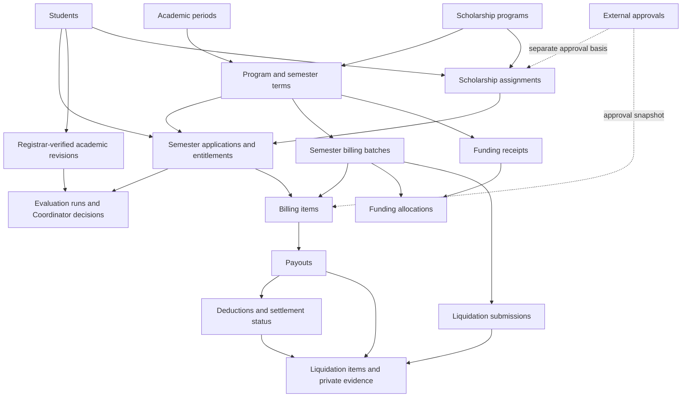

# Scholarship Management System implementation plan

Cronasia Foundation College, Inc. (CFCI)  
Review date: 2026-11-10, Asia/Manila  
Inspected application commit: `a345c39`  
Status: baseline design with CFCI's subsequent direct-validation clarification applied. Reported Registrar grade columns, configured active/source periods, direct validation and existing award-status safeguards are tracked in [progress.md](progress.md). Scope and verified national sources are in [eligibility-rules.md](eligibility-rules.md). Conversion, thresholds/full scale and required academic interpretation remain unconfirmed; scholarship application processing, including EDUKAR/AKLAT intake/requirements/exceptions, is excluded. Semester billing preparation/submission is implemented in Tasks 6/7; actual funding, payouts and liquidation in Task 10; live dashboard analytics and basic reporting in Task 11. See [billing-batches.md](billing-batches.md) for the explicit per-semester amount/policy confirmation boundary. The original inspection below is historical context, not a current inventory.

This plan is based on the repository and the school's requirements supplied in this conversation. It does not establish external scholarship policy. Confirmed requirements, implementation proposals, and unresolved decisions are identified separately. See [progress.md](progress.md) for verification results and the work tracker.

## Complete integration review (2026-11-12)

Task 12 in [progress.md](progress.md) and [integration-review.md](integration-review.md) verify the three official modules against the requested ten-step process. Final suites pass on SQLite and isolated MariaDB, including real concurrency. A confirmed academic-document download checksum defect and a database-specific test assertion were fixed. The latest dashboard-only presentation is preserved. Production rollout remains blocked by unresolved academic policy/configuration, dependency advisories and outstanding deployment/recovery/school acceptance requirements; successful synthetic downstream fixtures are not approved school criteria.

## Reporting and overview dashboard delivered (2026-11-12)

Task 11 in [progress.md](progress.md) and [reporting.md](reporting.md) supersede earlier descriptions of sample dashboard values and unimplemented basic reporting. The existing Cronasia dashboard presentation now uses real, scoped database records. Program/year/semester filters, distinct scholar counts, latest current validation states, active-award distribution, submitted billing, actual posted funding/student net payments and incomplete batch liquidation reuse the established models and source checks.

The latest presentation request removes the separate Reports pages and printing routes; analytics now use the dashboard indicators and graphs. Counting units, exclusions, current-state versus historical-period interpretation and separate school/direct financial paths remain explicit. Recent Validations reuses the existing evaluation queue/detail, with a contained, scrollable table and wrapping identities. No migration, financial mutation, historical status reconstruction, imported dataset or new eligibility/accounting rule is introduced. Provider-specific official forms, historical as-of reconstruction and broader R14 import/export requirements remain separate decisions.

## Financial recording and liquidation delivered (2026-11-12)

The user's current request authorizes the basic funding/payment/deduction/liquidation recording workflow. Task 10 in [progress.md](progress.md) and [financial-records.md](financial-records.md) supersede earlier “posting not started” descriptions for this specific scope. Existing financial relationships and restrictive/immutable history are reused, with additive migration `000008`.

Finance records real receipts and payment drafts; separate Administrator verification and intact evidence are required before posting. Received cash, batch cash allocations, school-paid student net, verified direct-to-student payments, authorized retained deductions and actual settlement remain distinct. Student IDs are snapshotted from the existing identity. No budget or bill becomes received/paid automatically. Transactions use current locking reads and scope locks to reject competing overspending under MariaDB repeatable-read isolation.

Deduction permission is never inferred from school charges or a percentage: each exact case requires applicable program/provider written authority, beneficiary consent/approved basis, reason and evidence verified by another Administrator. Unknown permission blocks it. Existing batch-scoped liquidation stores actual net/settlement coverage, shows incomplete cases, freezes submissions and supports independent accept/return plus simple printing. These are local reconciliation summaries, not an assumed official provider filing template.

R08/R09/R10/R11 remain open for broader pooling, transfers/returns, partial settlements, production reversals, provider-specific restrictions and official liquidation scope/deadlines. No additional policy or complex accounting engine is introduced. Verification, including real concurrent posting and preservation of all existing application/demo records, is recorded under Task 10.

## Scholar Information enhancement delivered (2026-11-11)

The user's complete Scholar Information requirements are implemented in the existing module. [Scholar Information field mapping and operation](scholar-information.md) and Task 9 in [progress.md](progress.md) are the current references; historical minimal Student definitions below are superseded only for this supporting function.

- Reuse existing identity/name/contact columns, Student relationships, staff policies, `academic_periods`, Registrar revisions, scholarship history and financial gates. Add 24 nullable Student columns using additive migration `000007`; preserve all existing records.
- Add a minimal `academic_programs` reference list because inspection found no registered academic-course table. Keep it distinct from scholarship programs, with Administrator registration and availability controls. No duplicate enrollment, scholar or location tables are introduced.
- Store the current administrative program/year/semester on the Student profile and retain dated academic selections in immutable audit snapshots. Keep certified enrollment/course/grades in the existing Registrar workflow, with its original verification/correction authority and uniqueness rules. Profile progression never overwrites those records; referenced period identities are retained.
- Support basic saveability and computed official completeness independently. Full forms/detail/directory use the existing Blade design, readable options and null unknown states. No complete flag grants scholarship eligibility or bypasses exact-semester financial approval.
- Encrypt the three official identifiers, hide/redact them in ordinary output/audits, restrict protected details to existing profile staff and keep sensitive values out of flashed validation input. Normalize supported phone formats while retaining unchanged legacy values for review.
- Update fictional factories without modifying completed datasets or manual students. New profile fixtures are isolated in a separate demo database. Tests, migration preservation, real browser checks and operation are recorded in Task 9; existing scholarship policy and unresolved school inputs remain unchanged.

## Confirmed scholarship fund policy (2026-11-11, latest clarification)

The user's [confirmed allocation policy](confirmed-allocation-policy.md) supersedes earlier monetary figures and provisional financial authority in this plan. Billing manages scholarship funds and budgets; it is not tuition billing or student payment collection.

- Initial configurable reference values: **TES PHP 7,500; TDP PHP 13,500; CoScho PHP 45,000 per semester**. Additional programs are supported; retained EDUKAR records are not deleted. Neither these references nor the school's 2007 establishment date creates rates, assignments or eligibility for past semesters.
- Administrators manage programs, academic periods, versioned semester rates and budgets. Finance prepares/submits batches; another Administrator approves. Finance/Administrator dual membership does not permit self-approval of a prepared or submitted batch.
- Eligibility requires an active student, one active assignment covering the selected semester, a current completed qualified validation, verified exact-semester approval and an approved semester rate. Missing school grading rules or an unconfirmed program eligibility profile still blocks allocation. No CoScho eligibility rules are invented.
- One allocation/reservation per **student and semester**, across all programs and assignment changes. This strengthens the older assignment/semester key, which remains in place. Administrators close old assignments and authorize new pending assignments; existing validation/activation gates remain required. Financial history is not moved or recreated when programs change.
- A batch pins its approved rate. New revisions affect new batches; approved history retains its original amount. Approval and adjustments are append-only records alongside the immutable submitted batch/items. Adjustments require an Administrator, reference, reason and fresh sequence; increases require current eligibility, an approved rate and budget capacity. Reductions cannot erase already released funds.
- Approved budget is a planning limit, not a cash receipt. Only Administrator-approved allocations consume budget; pending submissions are shown separately. Reports keep original amounts, adjustments, remaining budget, posted actual receipts and posted net releases distinct. Receipt/payout posting and cash settlement/reversal workflows are not added by this change.
- Academic years from **2007-2008 onward**, including future years, are supported. There is no assumption that any scholarship program operated from 2007.

The operational implementation is documented in [billing-batches.md](billing-batches.md); verification appears in [progress.md](progress.md). Earlier contradictory references below are historical and superseded by this section.
## CFCI clarification accepted on 2026-11-11

Use existing student academic records for direct scholarship validation. The confirmed display format contains subject Prelim, Midterm, Semi-Final, Final, Average, Equivalent, units and remarks. Record values as reported; do not infer a conversion formula, passing threshold or complete scale from examples. Those interpretation rules remain pending, and missing required policies/data produce `needs_review` rather than automatic eligible/ineligible.

The target is the configured active academic year/semester. The grade-source semester must follow a separately confirmed school policy/reference; first semester and 2026-2027 are not defaults. The current context and source revisions must be pinned to each validation, and changes must invalidate reliance on older decisions.

Application processing is outside scope. EDUKAR/AKLAT applicants deal directly with the provider; do not build its application requirements, submission flow or exceptions. Existing `scholarship_applications` storage is retained only as legacy internal semester-validation context to preserve data/FKs/history. Earlier application-intake descriptions below are superseded by this clarification; they are not authorized future work. Continue verifying only applicable official TDP/TES conditions, without inventing school grading rules or an EDUKAR application engine.

## 1. Scope and confirmed requirements

The three official modules are:

1. **Automated Scholarship Validation and Evaluation**
2. **Billing, Liquidation, and Deduction**
3. **Reporting, Analytics, and Overview Dashboard**

Scholar records, scholarship programs, academic periods, and scholarship assignments support these modules. They are supporting functions rather than additional official modules. Applications, evaluations, and financial transactions belong to the corresponding official module.

| Program | School-stated amount per semester | School planning duration | Treatment in the proposed system |
| --- | --- | --- | --- |
| TDP | PHP 7,500.00 | 4 years | Record the stated amount and planning duration with their source. Confirm the amount's financial meaning before using it for billing. |
| TES | PHP 13,500.00 | 4 years | Same treatment as TDP. |
| EDUKAR | Unconfirmed | 5 years | Store the amount as unknown/null. Require confirmation before financial posting; never substitute zero or another program's amount. |

The following are confirmed:

- A student may have only one active scholarship across all programs.
- Billing is by semester and supports multiple batches.
- The Registrar verifies academic records.
- The Coordinator performs school-level evaluation.
- External program approval is recorded separately from school evaluation.
- Financial records must track funding, payouts, deductions, and liquidation evidence.
- Existing authentication and the dashboard design must be preserved.

Planning durations are descriptive. They must not automatically disqualify a student after four or five years, close an assignment, calculate a guaranteed lifetime entitlement, or prohibit renewal. No grade, income, age, unit-load, or document eligibility threshold has been confirmed.

## 2. Repository inspection and reusable implementation

Paths below are relative to the repository root. They describe code and committed migrations, not a live production database inventory.

| Area | Evidence | Finding and reuse |
| --- | --- | --- |
| Framework | `composer.json`, installed Composer packages, `php artisan --version` | Laravel **12.69.2**, constraint `^12.0`; PHP constraint `^8.2`. Installed Breeze is 2.4.2. Retain the application and dependencies' architecture. |
| Frontend | `package.json`, `package-lock.json`, `vite.config.js`, `tailwind.config.js`, `postcss.config.js` | Blade, Alpine.js 3.17.2, Tailwind CSS 3.4.19, Vite 7.3.6; Axios is initialized. Current CSS processing uses Tailwind 3 through PostCSS. `@tailwindcss/vite` 4 is also declared but is not wired into Vite; no styling migration is needed for this work. |
| Application structure | `app/Http/Controllers`, `app/Http/Requests`, `app/Models`, `app/View/Components`, `resources/views` | Conventional Laravel MVC, Form Requests, Eloquent, and Blade components. Keep a single Laravel application with server-rendered pages. |
| Bootstrap | `bootstrap/app.php`, `app/Providers/AppServiceProvider.php` | Web routing, console routing, and `/up` health endpoint. No custom domain middleware, policies, or business services are configured. |
| Routes | `routes/web.php`, `routes/auth.php`, `php artisan route:list --except-vendor` | 18 application routes: root redirect, dashboard, profile, login/logout, password flows, and email verification. `/up` is separately configured by the framework. No scholarship or financial routes exist. |
| Authentication | `app/Http/Controllers/Auth/*`, `app/Http/Requests/Auth/LoginRequest.php`, `app/Models/User.php` | Login/logout, password reset, password confirmation/update, hashed passwords, CSRF forms, login rate limiting, and session regeneration are reusable. Public registration is deliberately absent. |
| Profiles | `ProfileController.php`, `ProfileUpdateRequest.php`, `resources/views/profile/*` | Profile edits, unique-email validation, password changes, and password-confirmed account deletion work. Preserve their behavior during this planning phase. Future historical-record retention needs an explicit deletion policy. |
| Dashboard | `DashboardController.php`, `resources/views/dashboard.blade.php` | Manila-time greeting/date and a rendered dashboard are implemented. Scholarship statistics, applicant rows, program distributions, and trends are hard-coded arrays. Reuse the presentation and its current controller-to-view data shape. |
| Shared design | `resources/views/layouts/*`, `resources/views/components/dashboard-*`, `resources/css/app.css`, `public/images/*` | Branding, navigation, cards, icons, responsive styles, SVG charts, focus styles, image fallbacks, and skeleton/empty/error markup exist. Preserve these assets and layouts. Loading/error states are mostly local demonstration states, not connected data loading. |
| JavaScript | `resources/js/app.js`, `resources/js/bootstrap.js`, Alpine directives in views | Alpine supports menus, password visibility, chart hover/focus, and local display state. There is no scholarship API or implemented search/filter request. |
| Database | Three files in `database/migrations` | Eight Laravel tables are declared: `users`, `password_reset_tokens`, `sessions`, `cache`, `cache_locks`, `jobs`, `job_batches`, `failed_jobs`. Laravel also manages its migration bookkeeping table. There are no domain migrations. |
| Models/controllers | `app/Models/User.php`, controllers listed above | `User` is the only application model. Controllers cover authentication, profile, and dashboard only. |
| Seed data | `database/seeders/DatabaseSeeder.php`, `database/factories/UserFactory.php` | The seeder creates `test@example.com`; its factory uses the password `password`. This is development test data, not an account provisioning process for school staff. |
| Automated checks | `tests/Feature/*`, `tests/Unit/ExampleTest.php`, `phpunit.xml` | 26 passing tests, 67 assertions. Tests cover authentication/profile and dashboard rendering. They use SQLite in memory and do not establish MySQL concurrency behavior or scholarship-rule correctness. |

The Laravel database queue/cache/session infrastructure can be reused if needed. Their existence does not mean scholarship automation, financial batch processing, notifications, or liquidation jobs are implemented.

## 3. Missing features and conflicting designs

| Area | Gap or conflict | Consequence for implementation |
| --- | --- | --- |
| Module 1 | No scholar/student records, academic periods, program configuration, academic verification, rule evaluation, external approval, or assignment persistence | Build the supporting records and distinct decision stages before automating eligibility. |
| Module 2 | No semester bills, billing batches, funding receipts, allocations, payouts, deduction details, or liquidation records/evidence | A single balance field or an application `paid` flag cannot represent the required financial history. |
| Module 3 | Dashboard presentation exists; persisted reporting and analytics do not | Keep the design and replace sample inputs with scoped database aggregates after the source workflows exist. |
| Program meaning | Dashboard examples call College, Senior High, Technical-Vocational, and Graduate Studies “programs” | These describe educational groupings. Scholarship programs must be TDP, TES, and EDUKAR. Keep course/education data separate and change data labels later without redesigning cards. |
| Approval meaning | Display labels include Qualified, Complete, For Evaluation, and Under Review without a persisted state model | Define document completeness, automatic checks, school qualification, external approval, assignment activity, and payment independently. “Qualified” must not imply external approval or payout. |
| Email verification | `routes/web.php` applies `verified`, but `User` does not implement `MustVerifyEmail` | A direct check of the installed middleware allowed an unverified user through with HTTP 200. Decide whether verification is required, then explicitly configure and test that policy. No authentication code is changed by this plan. |
| Access control | No roles/policies; the navigation prints “Administrator” and `FC` for all users | Add explicit staff roles and policies before domain write routes. A UI label grants no permission. Existing users must be assigned roles deliberately. |
| UI actions | Navigation, New Application, and row actions mostly point to anchors; academic-year/period selections only close menus; search has no implementation | Connect these controls gradually to real routes and filters while retaining layout, classes, and interaction styling. Announcements are currently a hidden empty section and are outside the confirmed module scope. |
| Dashboard correctness | Fixed years/totals, a CSS-fixed donut, program percentages totaling 75% although counts total 120 | Derive counts, percentages, accessible chart text, tooltips, and chart ranges from the same filtered dataset. Do not change just the headline numbers. |
| Database setup | README requires MySQL, while `.env.example` and the fallback in `config/database.php` use SQLite | Proposed production target is MySQL, subject to confirming its version. Resolve setup documentation and test actual database constraints before migrations are accepted. SQLite remains useful for ordinary tests. |
| Setup/auth documentation | README advertises `/register`, but registration tests explicitly expect 404 | Retain closed registration unless the school requests a different provisioning model; update documentation in a later authorized implementation phase. |
| Mail and history | Example mail transport logs messages; current profile deletion physically deletes users | Confirm real mail delivery and staff identity retention before deployment or attaching new historical records. Never cascade-delete academic or financial history when a login account is removed. |
| Maintenance | The preceding repository review at the same application commit reported Composer and npm security advisories | Schedule reviewed dependency updates before deployment. This planning change does not update packages. Those earlier audits reported 12 Composer advisories across six packages and six affected npm packages, all marked as development dependencies. |

## 4. Proposed implementation shape

Retain Laravel, Breeze, Blade, Alpine, the existing auth/profile routes, and the current dashboard layout. Use Eloquent relationships, Form Requests, policies, ordinary database transactions, and small action/service classes only for operations spanning several records: evaluation, assignment activation, payout posting, and liquidation acceptance. No SPA rewrite, microservices, generic workflow engine, accounting package, or new permissions package is proposed.

Use `students` as the person/academic identity. A scholar record is a student with an assignment and semester history; it does not require a duplicate `scholars` identity table. `users` remains login identity. Linking a student to a login is optional and depends on whether a student portal is required.

The proposed minimum workflow is:

1. Configure TDP/TES/EDUKAR and an academic period; confirm the applicable rules and financial terms for that semester.
2. Record a student and semester application. Pin the academic-record revisions used as evidence.
3. Registrar verifies academic records. Unverified data remains pending and cannot be presented as Registrar-verified.
4. Run only confirmed automated checks. Record each check's input, rule version, result, and reason. Missing rules/data produce `needs_review`, not invented eligibility or automatic rejection.
5. Coordinator records school qualification or a request for corrections, with reasons and any authorized override.
6. Record the external authority's decision independently, with its reference, scope, date, recorder, and evidence. Recording an approval does not mean the Coordinator issued it.
7. Activate/link the longer-lived scholarship assignment under the approved activation policy and the one-active constraint.
8. Authorize the semester gross entitlement; prepare billing items in one or more batches. Record actual funding separately, then payouts, deductions, and liquidation evidence.
9. Build reports and dashboard figures from those records.

Steps 6–8 are a proposed safe ordering, not a confirmed rule about when the school may submit bills or activate assignments. Decisions R03, R04, and R07 below determine their final gates. Billing submission must not itself create a funding receipt or mark a scholar paid.

## 5. Proposed database structure

This is a logical schema for review, not migration code. It deliberately separates facts with different lifetimes: a student, a scholarship assignment, a semester assessment/entitlement, a bill, received money, released money, and accepted liquidation evidence.

The proposal introduces 20 tables in stages, including one small role-membership table. It reuses the existing `users` and infrastructure tables. A semester application also represents that semester's assessment and authorized entitlement, avoiding separate application, renewal, and award tables for the same event. If the school requires several independent awards for the same student/program/semester, revisit that simplification before migrations.

All new business tables have a primary key and timestamps. Use foreign keys for relationships, indexed references/status/date filters, fixed-precision `DECIMAL(12,2)` PHP amounts, and explicit posting/decision timestamps. Dates and amounts below may remain null in drafts; the relevant transition must reject missing required values. Never use floating point or zero as an unknown amount. The date/time storage proposal is UTC timestamps with Asia/Manila display and local academic-period dates.

### Supporting records and access

| Table | Principal proposed fields | Key constraints and purpose |
| --- | --- | --- |
| `user_roles` | `user_id`, `role` | Unique `(user_id, role)`. A small allowlist can support administrator, registrar, coordinator, finance, and reporting/viewer responsibilities without assuming one person has only one role. Exact permissions remain subject to R12. |
| `students` | `student_number`, name fields, contact details, optional unique `user_id`, `record_status` | Unique institution-issued student number. Do not use name/email as identity. Course/year-level history belongs in semester academic records. No scholarship status or financial balance on this table. |
| `scholarship_programs` | unique `code`, display name, `school_stated_semester_amount` nullable, `planning_duration_years`, source notes, `is_active` | TDP/TES/EDUKAR only as confirmed program records. Amounts and durations carry their school-stated meaning; changing a default must not rewrite historical entitlements. Deactivation preserves history. |
| `academic_periods` | academic-year label, semester code, start/end dates, `is_open` | Unique `(academic_year, semester_code)`; end date follows start date. Billing/benefit period is explicit. Do not assume summer terms or a fixed number of semesters until R05 is settled. |
| `program_period_terms` | `program_id`, `academic_period_id`, `semester_gross_amount` nullable, confirmed criteria/checklist definition, rule-version label, source/reference, `confirmed_by`, `confirmed_at` | Unique `(program_id, academic_period_id)`. One agreed terms record per program/semester is the simplest starting point. Freeze it once used for a finalized evaluation/bill; mid-semester policy/rate changes require the revision decision in R01/R02. No generic rule language is proposed. |

### Module 1: Automated Scholarship Validation and Evaluation

| Table | Principal proposed fields | Key constraints and purpose |
| --- | --- | --- |
| `academic_records` | `student_id`, `academic_period_id`, revision number, course/year level, enrollment status, nullable grade/unit summaries, source/reference, `verification_status`, `verified_by`, `verified_at`, verification notes, optional `supersedes_id` | Unique `(student_id, academic_period_id, revision)`. Registrar verifies a specific revision. Verified revisions are retained; corrections produce a new revision and trigger reassessment of affected current applications. Exact grade fields/scales depend on R02. |
| `scholarship_applications` | `student_id`, `program_period_term_id`, nullable `assignment_id`, submission revision, submission status/date, nullable `approved_gross_amount`, amount-authorizer/date/basis | Proposed unique `(student_id, program_period_term_id)`: one semester application per student/program, with resubmission history rather than duplicate rows. This is a proposal, not an additional confirmed eligibility rule. Initial and renewal applications share the structure. Amount is an authorized semester snapshot, not a mutable program default. |
| `evaluation_runs` | `application_id`, run number, application revision, `grade_record_id`, `enrollment_record_id`, input/rule snapshots, structured check results, automatic outcome, Coordinator decision/user/date/reason, override reason | Unique `(application_id, run_number)`. Grade-source period can differ from the benefit/enrollment period. JSON is limited to rule/input/result snapshots; identities, money, relationships, and decision fields remain relational. A completed run is immutable. A later run requires a fresh Coordinator decision. |
| `external_approvals` | `student_id`, `program_id`, scope (`assignment` or `semester`), nullable `assignment_id` and `academic_period_id`, optional source `application_id`, decision, authority/reference, decision date, validity information, `recorded_by`, optional `supersedes_id` | Separate external decision records, including rejection/revocation where applicable. Semester scope requires a period; assignment scope requires its specific assignment and confirmed validity. References may be shared by a list of scholars, so reference alone must not be globally unique. No automatic carry-forward until R03 is confirmed. |
| `scholarship_assignments` | `student_id`, `program_id`, start period/date, nullable end period/date, activity status, chosen external approval reference, activation/closure actor and reason | One row represents a longer-lived student/program assignment. Applications link to it across semesters. Retain completed/suspended/ended history. Enforce at most one active assignment for a student across every program; duration is not an expiry calculation. |

The effective school decision is the decision on the latest applicable evaluation run for the current application revision. No current completed decision means pending review. A new submission or academic correction invalidates reliance on an older decision for future posting; it does not rewrite historical bills or payments.

External approval can be referenced by the assignment and by a finalized billing item's approval snapshot. Validate that it belongs to the same student/program and covers the intended assignment/period. A pending assignment may be created to anchor an assignment-scoped decision; it does not occupy the active scholarship slot. The two supported scope shapes above allow the school to resolve R03 without conflating external approval with school qualification.

### Module 2: Billing, Liquidation, and Deduction

| Table | Principal proposed fields | Key constraints and purpose |
| --- | --- | --- |
| `billing_batches` | `program_period_term_id`, batch number/reference, draft/submitted/finalized/void status, preparation/submission/finalization actors and dates | Unique `(program_period_term_id, batch_number)`. Multiple batches per program/semester. Proposal: each batch covers one scholarship program and one semester; confirm in R07. Stored status describes the bill, not payment. |
| `billing_items` | `billing_batch_id`, `application_id`, `assignment_id`, academic-period/student/program context, relied-on `evaluation_run_id` and `external_approval_id`, `gross_amount`, entitlement/basis snapshot | Updated by the 2026-11-11 requirement: one bill per assignment and semester across all batches, with a unique application reference. This supersedes tentative split-billing. Different students can occupy different batches, and payouts can represent installments if later authorized. Void/correction handling must retain this uniqueness and history. |
| `funding_receipts` | `program_period_term_id`, actual amount received, receipt date, funder/source, bank/receipt reference, posting status, recorder | Record actual received money, distinct from a submitted bill or expected funding. Proposal: receipt scope is one program/semester; pooled receipts spanning scopes need the R08 adjustment before migration. |
| `funding_allocations` | `funding_receipt_id`, `billing_batch_id`, amount, posting date/status, recorder | Explicit many-to-many funding allocation: a receipt can fund several batches and a batch can receive several receipts. Allocations cannot exceed the receipt; receipt and batch scope must agree. Multiple allocations for the same pair are possible, with posting idempotency. |
| `payouts` | `billing_item_id`, gross amount applied, net cash paid, payout date, beneficiary/payee snapshot, method/reference, posting status, poster, unique posting key | Multiple payout rows can represent installments if authorized. Gross and net amounts have different meanings. Cumulative posted gross cannot exceed the billed amount or available gross funding allocation. A bill/receipt never substitutes for a payout. |
| `deductions` | `payout_id`, type/code, amount, approved basis/reason, authorizer, destination, settlement status/date/reference | Itemize deductions against a specific payout. Never store only an unexplained total. Track a retained/unsettled deduction separately from a deduction actually settled to its destination. Partial settlements require an additional settlement table if R09 requires them. |
| `liquidations` | `billing_batch_id`, sequence/reference, preparation/submission dates, draft/submitted/accepted/returned status, reviewer/date/notes | Multiple submissions per batch preserve returned/corrected evidence. The batch-based scope is a proposal subject to R11; receipt-based liquidation needs an allocation link before migration. “Submitted” does not mean accepted or paid. |
| `liquidation_items` | `liquidation_id`, either `payout_id` or `deduction_id`, amount supported, verification notes | Exactly one financial target per line. Under the proposed cash basis, a payout line covers net cash, while a deduction line covers an actually settled deduction. Cap cumulative accepted coverage by the target amount and ensure the target belongs to the same batch. This prevents claiming gross payout and its deductions twice. |

### Shared evidence and history

| Table | Principal proposed fields | Key constraints and purpose |
| --- | --- | --- |
| `documents` | private disk/storage key, original name, type/checklist code, MIME/size/checksum, uploader/date, review status/reviewer/date/notes, optional replacement link; nullable owner FKs for application, academic record, external approval, funding receipt, payout, deduction, or liquidation | Exactly one owner FK is populated. This explicit small owner set allows foreign keys and avoids unvalidated polymorphic ownership. One owner can have several files/revisions. Upload/presence is distinct from accepted evidence. Financial owners cannot lose required evidence through ordinary deletion. File existence, access, and ownership are also checked in the application. |
| `audit_events` | actor FK and identity snapshot, action, entity type/id, event time, effective date where applicable, reason, limited before/after state or decision payload, correlation/reference | Append-only history for decisions, overrides, assignment changes, evidence changes, and financial transitions. Retain effective dates for backdated assignment changes if permitted by R04. Entity type/id is a navigational reference, not the evidence integrity mechanism. Do not log passwords, tokens, or entire uploaded documents. |

Use archival/restrictive deletion for business records and explicit correction links for posted financial records. Do not cascade deletion of a student, program, assignment, user, or document into historical financial transactions. A staff-account removal policy must preserve actor identity through snapshots and an agreed FK/deactivation/anonymization strategy.

Use additive migrations rather than rewriting the existing Laravel migrations. Introduce evidence owner columns/FKs alongside their module's parent tables. Add nullable cross-references between assignments and external approvals after both tables exist; populate and validate them during the appropriate decision transition. Do not create references to tables scheduled for a later phase. The reversal/correction links and record kinds for financial tables must be settled under R10 before those migrations are written.

### Relationships at a glance

## 6. Database and transaction rules

These are proposed integrity rules unless explicitly identified as confirmed. They must be tested against the selected MySQL version, not only SQLite.

1. **One active scholarship is confirmed.** Use a database-backed conditional uniqueness constraint on the student in `scholarship_assignments`. For MySQL, the proposed mechanism is a nullable generated active-student key with a unique index: active rows expose their student ID, historical rows expose null. Confirm engine support before migration. Do not use `UNIQUE(student_id, status)`, which would also prevent multiple historical records with the same status. Activation also locks the student row in a transaction. Two concurrent activations must leave at most one active row. Suspension, future activation, transfers, and retrospective overlaps still need R04.
2. **Keep context consistent.** Application, academic evidence, assignment, approval, bill, receipt, allocation, payout, and liquidation must agree on student/program/period as applicable. Use foreign keys and composite constraints where practical; perform cross-table scope checks in the same posting transaction. A foreign key alone does not prove matching ownership or period.
3. **Preserve decision sources.** Evaluation stores the exact verified record revisions and rule/input snapshots. Final billing stores its evaluation, external approval basis, entitlement, and amount snapshots. Later program changes cannot recalculate past obligations. Academic evidence may concern a previous semester; benefit/billing semester remains explicit.
4. **Freeze monetary authorization.** A null EDUKAR amount or unresolved amount meaning blocks its financial finalization. TDP/TES defaults do not prove a student is entitled, externally approved, funded, or paid. Do not multiply semester amounts by planning years to create an award.
5. **Prevent duplicate billing/payment.** The 2026-11-11 requirement now fixes billing uniqueness: one item per assignment and academic period across batches, including draft/void records. The item's gross must remain within the authorized semester amount; sum of posted payout gross per item must not exceed its bill amount. Aggregate posting checks are future services, not implemented workflow. Unique posting keys prevent repeated submissions. A bank/reference string alone is not a reliable unique key because one transaction may cover multiple students.
6. **Separate gross, net, and deductions.** For each ordinary payout, `net cash paid = gross amount applied - sum(authorized deductions)` and all amounts are nonnegative. Deduction totals cannot exceed gross. Store and validate the equation atomically. No tuition balance, deduction percentage, payment priority, or automatic deduction source is inferred.
7. **Separate funding from disbursement.** Sum of posted allocations cannot exceed the corresponding receipt. Across the entire batch, cumulative posted gross payouts consume allocation capacity, including the reserved obligation for unsettled deductions. Lock the batch and affected receipts/allocations when posting or reallocating; an allocation cannot be removed below already consumed capacity. Actual cash outflow is net cash paid plus deductions actually settled, not gross plus deductions. This proposed reserve model needs R08/R09 confirmation. A bill may exist before money arrives; posting payouts requires the approved funding checks.
8. **Keep liquidation coverage explicit.** Accepted liquidation amounts cannot exceed supported net payouts or settled deductions, including coverage in earlier accepted submissions. Returned drafts do not count as accepted coverage. Evidence belongs to the financial scope it supports. Do not infer “fully liquidated” from file upload alone.
9. **Retain posted history.** Posted receipts, payouts, deductions, and accepted liquidations are not silently edited/deleted. Corrections must preserve the original, a linked reversal/correcting record, authorizer, date, reason, and evidence. Aggregates must handle reversals exactly once. Returns of unused funding and transfers require their own explicit transaction representation if R08/R11 includes them; do not disguise them as negative ordinary receipts/payouts.
10. **Do not store a mutable scholar balance as truth.** Derive entitlement remaining, billed amount, gross applied, net paid, deduction liability/settlement, funding available, and accepted liquidation from their respective records. A report must not label received funding as paid or school-qualified students as externally approved.

Use nonnegative amount/date/owner checks where supported, plus transition validation in the application. Uniqueness/FK constraints belong in the database. Aggregate financial limits require locking and transactional checks; ordinary per-row validation does not prevent races. Verify the one-active constraint, financial posting races, and relevant CHECK behavior on MySQL during implementation.

## 7. Proposed access boundaries

| Responsibility | Proposed access | Confirmed versus proposed |
| --- | --- | --- |
| Registrar | Enter/correct academic records and verify academic revisions | Verification responsibility is confirmed. Exact edit/correction permissions need review. |
| Coordinator | Manage applications, review automatic results, record school evaluation, prepare external submissions and record received decisions | School-level evaluation is confirmed. External-decision recording permission is proposed; it does not grant external approval authority. |
| Finance | Prepare billing, record funding, allocations, payouts, deductions, and liquidation submissions | Financial role and posting/approval separation need confirmation. |
| Administrator | Provision accounts/roles and maintain approved configuration | Proposed; administrator status must not automatically mean Registrar verification or external approval authority. |
| Reporting/viewer | Read authorized reports and dashboard aggregates | Proposed; access to personal data and evidence remains scoped. |

A student portal, an external approver login, and automatic integration with external agencies are not confirmed. Start with staff-managed records unless the school approves otherwise. Every mutation and evidence download needs a server-side policy; hiding a button is insufficient.

## 8. Reporting and dashboard integration

Preserve the dashboard's layout, images, cards, charts, component classes, mobile behavior, and Manila-time greeting. Keep its current view-data keys (`hero`, `stats`, `applications`, `qualified`, `statuses`, `recentApplications`, `programs`, `quickLinks`) while replacing their sources in a later phase. Do not rename existing routes or remove current authentication/profile flows as part of data integration.

Proposed initial reporting definitions, subject to R14:

| View/report | Proposed source and meaning |
| --- | --- |
| Application overview | Count distinct submitted semester applications for the selected academic period and program. Drafts/withdrawals need explicit inclusion rules. |
| Evaluation queue | Submitted applications whose current revision lacks a completed applicable Coordinator decision. Show unverified academics and missing requirements separately. |
| Qualified applicants | Coordinator-qualified current applications. External approval is a separate indicator/filter. |
| Active scholars | Distinct students with an active assignment as of the reporting date; historical as-of reports use retained activity events and agreed effective dates. Semester-supported scholars are a separate measure. |
| Scholars by program | TDP/TES/EDUKAR distribution using the same active/support definition and denominator. Course distributions can be a separate report. |
| Semester/batch billing | Authorized gross, billed gross, outstanding entitlement, and batch history; distinguish billed from received. |
| Funding and payout register | Funding received/allocated, gross applied, net cash paid, unsettled/settled deductions, and unspent cash/remaining commitments as distinct columns. |
| Liquidation overview | Submitted and accepted supported amounts, outstanding evidence, reviewer status, and report references by the approved liquidation scope. |

Financial reports must reconcile distinct aggregates before joining them. Joining several billing items, payouts, deductions, and files directly can multiply rows and inflate totals. Report reversals consistently and record the period/program/as-of filters in exports.

Before switching dashboard data, update hard-coded years, chart descriptions, donut totals/segments, percentages, and tooltip text together. Compute chart ranges from real values rather than the current fixed 0–100 domain. Connect existing filters to real query parameters. New routes should respect the three official modules; supporting-record screens may reuse existing navigation styling. The exact navigation labels/grouping remain a review decision, not a reason to redesign the dashboard.

## 9. Decisions required before affected migrations or rules

No unanswered question below prevents completing this documentation. It does prevent guessing the affected production rule. The proposed schema remains subject to these decisions.

| ID | Unresolved school/technical rule | Why it affects correctness and when to settle it |
| --- | --- | --- |
| R01 | EDUKAR amount; whether TDP/TES amounts are gross entitlement, school billing, or net benefit; effective semesters, exceptions, and mid-semester rate changes | Determines authorized amount columns, snapshots, possible terms revisions, and billing caps. Record stated defaults now; confirm before financial migrations/finalization. |
| R02 | Eligibility checklist and documents per program; grading scale/thresholds, source grading semester, enrollment/units, failed/incomplete/dropped subjects, socioeconomic criteria, override authority, and mid-semester policy changes | Determines academic fields, rules, revision strategy, and permitted automated outcomes. Missing rules stay unresolved; do not invent a GPA/income rule. Settle before evaluation fields/rules are finalized. |
| R03 | External approval authority and evidence; initial/assignment-wide versus per-semester approval, validity, renewal, rejection/revocation, and whether approval must precede billing or payout | Determines scope/validity constraints and approval snapshots/gates. No automatic carry-forward. Settle before approval transitions and finance posting. |
| R04 | What starts/ends active status; whether suspension reserves the scholarship slot; transfer/reactivation, future-dated or retroactive changes, and overlap handling | The one-active rule is confirmed, but status/date semantics affect its exact constraint and historical reporting. Settle before assignment migrations/activation. Planning years never decide this automatically. |
| R05 | School academic-year/semester codes and dates, summer terms, and mapping prior academic evidence to the funded semester | Determines period keys and academic-source references. Settle before period/academic migrations. |
| R06 | One application per student/program/semester; renewal versus new application; resubmissions; simultaneous pending applications to other programs; legacy scholar onboarding without an original application | Determines uniqueness and required provenance. One active scholarship does not itself prohibit multiple pending applications. Settle before application constraints/imports. |
| R07 | Whether a billing batch is always one program/semester; batch numbering, supplemental/corrected batches, repeated scholars, partial billing/payouts, payees, and bill submission before external approval/funding | Determines line uniqueness, installment rules, and bill/payout lifecycle. Multiple batches are confirmed; multiple payouts per student are only a supported proposal. Settle before finance migrations. |
| R08 | Receipt earmarking by program/semester versus pooled funding; allocation/reallocation, partial receipts, unused-fund returns/transfers, and funding sufficiency basis | Pooled receipts need receipt line scopes; returns/transfers need explicit movement records. A batch-only receipt FK is insufficient for shared funds. Settle before funding migrations. |
| R09 | Permitted deduction types, legal/school authorization basis, source of tuition/other balances, caps/order, whether nominal amounts include deductions, recipients, timing, and partial settlements | Determines deduction calculation, settlement records, external balance imports, and gross/net reconciliation. Do not infer automatic tuition deduction. Settle before deduction/payout migrations. |
| R10 | Who can prepare, approve, post, reverse, and review financial records; handling cancellations, failed payouts, refunds, duplicate references, and corrections after posting | Determines statuses, approval fields, reversal/return design, and separation of duties. Settle before financial posting transitions. |
| R11 | Liquidation is per batch, receipt, program, or semester; cash versus gross reporting; accepted proof, partial submissions, returned evidence, unspent funds, deadlines, and reviewer authority | Determines liquidation parents/item coverage and any funding-to-evidence allocation bridge. Do not implement batch-only liquidation if reporting is actually receipt-based. Settle before finance schema is accepted. |
| R12 | Multi-role staff, account provisioning, student/external logins, email verification, account deletion/deactivation, and retention/access for academic and financial evidence | Determines role membership, optional student/user link, actor FKs, document requirements, and deletion behavior. Preserve current functionality until an approved retention-compatible change is specified. Settle before domain identity/evidence FKs. |
| R13 | Actual MySQL product/version and deployment conventions; whether SQLite is test-only; database constraint and locking support | Determines generated uniqueness/CHECK implementation and integration test environment. Do not infer the configured live database from README or inspect private credentials to answer this. Settle before migrations. |
| R14 | Historical import scope, stable student numbers and external references, reporting denominators/as-of dates, course versus scholarship grouping, required export formats | Determines import keys, historical assignment events, report semantics, and any additional academic detail. Settle before imports and report acceptance. |

## 10. Development order and acceptance gates

Phases below are future implementation work. Only inspection and documentation are completed in this change. Keep the existing dashboard and authentication available throughout.

| Phase | Work | Exit condition |
| --- | --- | --- |
| 0. Review and baseline | Review this schema; settle the decisions needed for the next phase; confirm MySQL/version and a baseline of current auth/dashboard behavior. Plan dependency maintenance and an explicit email-verification policy. | Reviewed foundation decisions and a reproducible database setup. No guessed eligibility or financial rules. |
| 1. Supporting records and access | Add scoped staff roles/policies, students, programs, academic periods, program/period terms, and the agreed evidence/audit foundation. Seed program reference data with school-stated values and EDUKAR null. | Authorized CRUD works; stable keys and ownership constraints are tested; existing users/auth/dashboard still work. Staff roles are assigned explicitly. |
| 2. Module 1: records and evaluation | Add academic revisions and Registrar verification; semester applications; confirmed automatic checks; Coordinator decisions and reasoned overrides. | Registrar and Coordinator permissions are distinct. Missing/unverified inputs remain pending. Evaluation is reproducible and corrections trigger a fresh decision. |
| 3. Module 1: approval and assignments | Add separate external decisions, their evidence/scope, assignment activation/renewal/closure under the agreed rules. | School qualification never impersonates external approval. MySQL concurrency tests prove one active scholarship per student. Planning durations cause no unconditional rejection. |
| 4. Module 2: billing and funding | After R01/R07/R08/R10/R11 settle, add semester batches/items, authorized amount snapshots, receipts, and allocations. Finalize the whole financial schema's scopes before its first migration. | Multiple batches work; billed/received/allocated totals remain distinct; no duplicate/excess billing or over-allocation under concurrent posting. EDUKAR cannot be posted with an unknown amount. |
| 5. Module 2: payout, deduction, liquidation | After R09 settles, add payouts, authorized deduction details/settlement, private evidence, liquidation review, and the agreed corrections/returns. | Gross/net/deduction equations reconcile. Partial and repeated submissions are handled as agreed. Accepted evidence cannot be reused beyond the supported amount; financial history survives correction. |
| 6. Module 3: reports and dashboard data | Add reports from finalized source records; connect academic/program filters and real routes; replace dashboard fixtures while preserving design and view-data keys. | Dashboard and reports agree for the same scope; empty datasets render correctly; shared joins do not inflate totals; visual comparison confirms the existing design is preserved. |
| 7. Acceptance and rollout | Validate approved school examples and historical imports; check permissions, MySQL concurrency, evidence access, backups/restores, mail configuration, and dependency maintenance. | School accepts program/financial reconciliation examples; no unresolved rule is silently encoded; existing functionality passes regression checks. |

Meaningful acceptance scenarios for future implementation include:

- Two concurrent attempts to activate TDP and TES for the same student leave one active assignment at most; multiple historical ended assignments remain valid.
- A fifth-year TDP/TES student is not automatically rejected because the planning duration is four years; EDUKAR's five-year value is also descriptive.
- Missing/unverified grades and unknown thresholds produce pending/manual review, not qualification. A later Registrar correction cannot leave a stale school decision usable for new billing.
- A school-qualified student with external approval pending remains visibly pending externally. Approval scope never carries into another semester without a confirmed rule.
- Under the 2026-11-11 duplicate-billing requirement, a second bill for the same assignment/semester is rejected even in a different batch. If installments are later authorized, they are payout records against the original bill rather than another bill.
- As an arithmetic example only, PHP 7,500 gross with an authorized PHP 500 deduction gives PHP 7,000 net. While the deduction is retained, cash paid is PHP 7,000 and the unsettled deduction is PHP 500. If separately settled and evidenced, accepted cash coverage can reach PHP 7,500, never PHP 8,000. Deduction permission is R09.
- EDUKAR can be recorded and reviewed with amount unknown, but no financial finalization uses zero or another program's rate as its entitlement.
- A shared funding receipt cannot be allocated twice; accepted liquidation cannot cover the same payout/deduction twice. Bill submission, funding receipt, payout, and liquidation acceptance remain separate events.
- Auth/profile regression tests continue to pass; dashboard desktop/mobile appearance is compared with the existing design before real data is switched on.

## 11. Assumptions and limits of this review

The proposed single-school, staff-managed, PHP-currency system, one semester application per program, one program/semester per billing batch, and batch-scoped cash-basis liquidation are review assumptions. They are not additional confirmed school rules. The decision table identifies how to change them before implementation if needed.

The original 2026-11-10 analysis inspected no live MySQL data, browser interaction, real mail delivery, external approval integration, or school document samples and changed only planning documents. On 2026-11-11 the user authorized the initial database foundation; migrations, models, and database tests are now implemented and verified on disposable databases. No existing application database, authentication tables, controllers, routes, dependencies, or dashboard assets were modified. The progress tracker records implemented constraints separately from unresolved workflow rules and future UI work.
