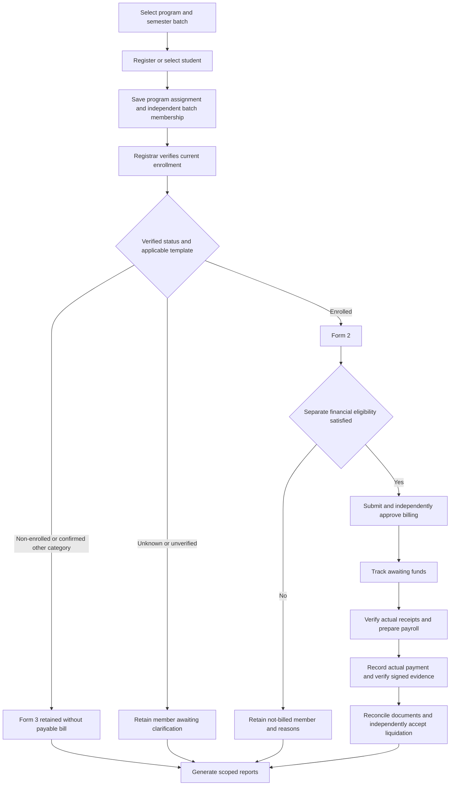
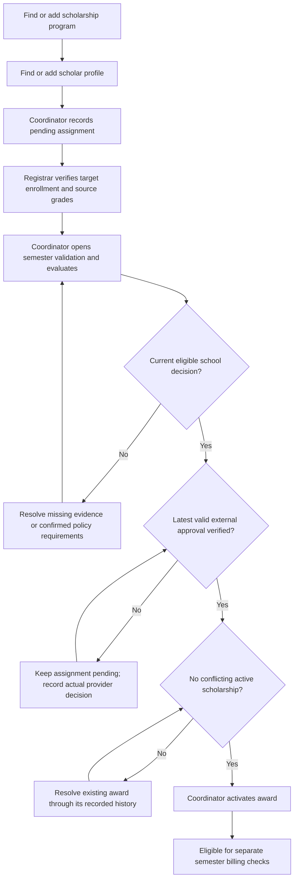

# Teacher-approved scholarship workflow

Reviewed against the repository on 2026-11-13 (Asia/Manila). The original analysis is retained with subsequent implementation amendments linked below.

The primary process is program -> semester batch -> student/program/batch membership -> Registrar enrollment validation -> applicable Form 2/Form 3 classification -> eligible enrolled billing -> awaiting funds -> actual receipts and payroll preparation -> actual payments and signed evidence -> reviewed liquidation -> reports.

1. [Scholarship program and batch](01-scholarship-program-and-batch.md).
2. [Scholar registration and assignment](02-scholar-registration-and-assignment.md).
3. [Enrollment validation](03-enrollment-validation.md).
4. [Form 2, Form 3 and billing](04-form2-form3-and-billing.md).
5. [Fund receiving, payroll and actual payments](05-fund-receiving-and-payroll.md).
6. [Liquidation](06-liquidation.md).
7. [The six required reports](07-required-reports.md).
8. [Implementation gaps, clarification register and minimal migration proposals](08-implementation-gap-analysis.md).

Each guide separates current capabilities from target steps. Task 24 in [progress](../sms/progress.md) adds independent semester rosters/membership, the Registrar queue, unbilled members and funding monitoring. One roster supports multiple submissions; submitted billing is billed and drafts are not. Task 25 adds a [basic internal school payroll register](../sms/payroll-preparation.md). Task 26 adds [signed acknowledgment and required liquidation evidence](../sms/signed-payroll-and-liquidation.md), preserving past acceptance. Task 27 delivers [all six internal reports with filters, CSV and complete print](../sms/six-reports.md). Form 2/Form 3 classification/gating, direct payroll preparation, official provider forms and historical as-of reconstruction remain separate work. Existing ledgers, authentication, roles and Cronasia styling are retained.

The diagram shows the target process, not a claim that all screens already exist. Form 2 alone does not establish payability; Form 3 is not payable in this workflow. Payroll preparation and receipt posting cannot mark a student paid or a billing liquidated. Reports can also be generated at intermediate stages.

## Retained guides for current screens

The earlier [program guide](01-scholarship-programs.md), [scholar/assignment guide](02-scholars-and-assignments.md) and [validation/approval guide](03-validation-and-approval.md) remain useful instructions for existing controls. Their three-step ordering is superseded by the primary process above. The following existing-screen role/activation guidance remains conditional on current policy and does not supply the missing form-classification or signature rules.

## Who performs each step

| Work | Normal responsible role | Where |
| --- | --- | --- |
| Maintain scholarship programs, academic periods and validation context | Coordinator | Scholarship programs; Academic periods |
| Register/update a scholar profile | Registrar or Coordinator | Scholars |
| Create a pending scholarship assignment or close an existing one | Coordinator | Scholar detail → Assign scholarship / Update status |
| Record and verify enrollment, grades and academic corrections | Registrar | Academic verification |
| Confirm applicable rules, evaluate, review scholarship evidence, record an external decision and activate an award | Coordinator | Evaluations |

The existing **Test Administrator** can test these responsibilities under the same record and eligibility guards. Registrar access to Scholars does not grant permission to assign or approve a scholarship. Provider approval is issued outside SMS; a Coordinator records and verifies the real decision in SMS.

## Existing evaluation and activation sequence

This older diagram explains the existing evaluation/activation gates within the broader primary process. It does not include the missing batch membership or classification. An external decision can be recorded earlier, but activation still requires both a current eligible school decision and a valid, verified approval for the exact assignment and semester.

## Current stopping point

**Normal production validation currently remains Needs review.** `SchoolGradingPolicy` deliberately returns review because CFCI's grade conversion, passing thresholds and complete academic interpretation rules are unconfirmed. Staff can register profiles, prepare assignments, verify academic records, evaluate and record actual external decisions. A new award cannot pass the activation gate until the approved school criteria are supplied and implemented. Selecting Passing, confirming a grading-source reference or uploading a certificate does not resolve that missing implementation.

The downstream activation sequence is documented so staff understand the intended gates; it is conditional on resolving that prerequisite. Synthetic test fixtures that exercise activation are not approved school rules. Programs without an applicable verified rule set also remain under review. See [eligibility rules and current limitations](../sms/eligibility-rules.md).

## What “active” and “approved” mean

| Record or result | Meaning | Does it approve an award? |
| --- | --- | --- |
| Scholarship program: Active | Program is available for award activation | No |
| Scholar record: Active | Administrative student profile is in use | No |
| Profile: complete | Required profile answers are present | No |
| Registrar record: Verified | Academic source information was checked | No |
| School evaluation: Eligible | Applicable school checks passed and the decision must still be current | Only one prerequisite |
| External decision: Approved | An actual provider/authority approval was recorded and verified | Only one prerequisite |
| Assignment: Active | Guarded award activation succeeded | Yes, the award is active; payment is still separate |

There is no separate **Approve scholarship program** or **Approve scholar profile** action. Program creation maintains the program catalog; individual award activation occurs in Evaluations. The Batch Number field on Add/Edit Program is a contextual reference and does not assign a scholar or create an award.

## Review basis

The guides were checked against the current [program controller](../../app/Http/Controllers/ScholarshipProgramController.php), [scholar controller](../../app/Http/Controllers/ScholarController.php), [assignment action](../../app/Actions/Records/SaveScholarshipAssignment.php), [evaluation controller](../../app/Http/Controllers/ScholarshipEvaluationController.php), [activation guards](../../app/Actions/Eligibility/ActivateAward.php), corresponding Blade views and policies. Current role decisions are documented in the [access review](../sms/auth-access-review.md); implementation and test history are in [progress](../sms/progress.md).
