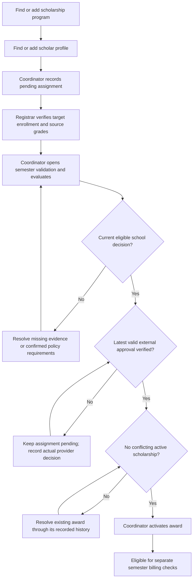

# Scholarship Programs and Scholars: workflow guide

Reviewed against the current application on 2026-11-12 (Asia/Manila).

Follow these guides in order when adding a new scholarship award:

1. [Set up or maintain a scholarship program](01-scholarship-programs.md).
2. [Register a scholar and record a pending assignment](02-scholars-and-assignments.md).
3. [Verify records, evaluate, record external approval and activate](03-validation-and-approval.md).

These instructions describe existing screens and guards. They do not introduce a new approval process or change school/provider policy.

## Who performs each step

| Work | Normal responsible role | Where |
| --- | --- | --- |
| Maintain scholarship programs, academic periods and validation context | Coordinator | Scholarship programs; Academic periods |
| Register/update a scholar profile | Registrar or Coordinator | Scholars |
| Create a pending scholarship assignment or close an existing one | Coordinator | Scholar detail → Assign scholarship / Update status |
| Record and verify enrollment, grades and academic corrections | Registrar | Academic verification |
| Confirm applicable rules, evaluate, review scholarship evidence, record an external decision and activate an award | Coordinator | Evaluations |

The existing **Test Administrator** can test these responsibilities under the same record and eligibility guards. Registrar access to Scholars does not grant permission to assign or approve a scholarship. Provider approval is issued outside SMS; a Coordinator records and verifies the real decision in SMS.

## Recommended sequence

This is the recommended staff handoff order. An external decision can be recorded earlier, but activation still requires both a current eligible school decision and a valid, verified approval for the exact assignment and semester.

## Current stopping point

**Normal production validation currently remains Needs review.** `SchoolGradingPolicy` deliberately returns review because CFCI's grade conversion, passing thresholds and complete academic interpretation rules are unconfirmed. Staff can register profiles, prepare assignments, verify academic records, evaluate and record actual external decisions. A new award cannot pass the activation gate until the approved school criteria are supplied and implemented. Selecting Passing, confirming a grading-source reference or uploading a certificate does not resolve that missing implementation.

The downstream activation sequence is documented so staff understand the intended gates; it is conditional on resolving that prerequisite. Synthetic test fixtures that exercise activation are not approved school rules. Programs without an applicable verified rule set also remain under review. See [eligibility rules and current limitations](../sms/eligibility-rules.md).

## What “active” and “approved” mean

| Record or result | Meaning | Does it approve an award? |
| --- | --- | --- |
| Scholarship program: Active | Program is available for award activation | No |
| Scholar record: Active | Administrative student profile is in use | No |
| Profile: complete | Required profile answers are present | No |
| Registrar record: Verified | Academic source information was checked | No |
| School evaluation: Eligible | Applicable school checks passed and the decision must still be current | Only one prerequisite |
| External decision: Approved | An actual provider/authority approval was recorded and verified | Only one prerequisite |
| Assignment: Active | Guarded award activation succeeded | Yes, the award is active; payment is still separate |

There is no separate **Approve scholarship program** or **Approve scholar profile** action. Program creation maintains the program catalog; individual award activation occurs in Evaluations. The Batch Number field on Add/Edit Program is a contextual reference and does not assign a scholar or create an award.

## Review basis

The guides were checked against the current [program controller](../../app/Http/Controllers/ScholarshipProgramController.php), [scholar controller](../../app/Http/Controllers/ScholarController.php), [assignment action](../../app/Actions/Records/SaveScholarshipAssignment.php), [evaluation controller](../../app/Http/Controllers/ScholarshipEvaluationController.php), [activation guards](../../app/Actions/Eligibility/ActivateAward.php), corresponding Blade views and policies. Current role decisions are documented in the [access review](../sms/auth-access-review.md); implementation and test history are in [progress](../sms/progress.md).
